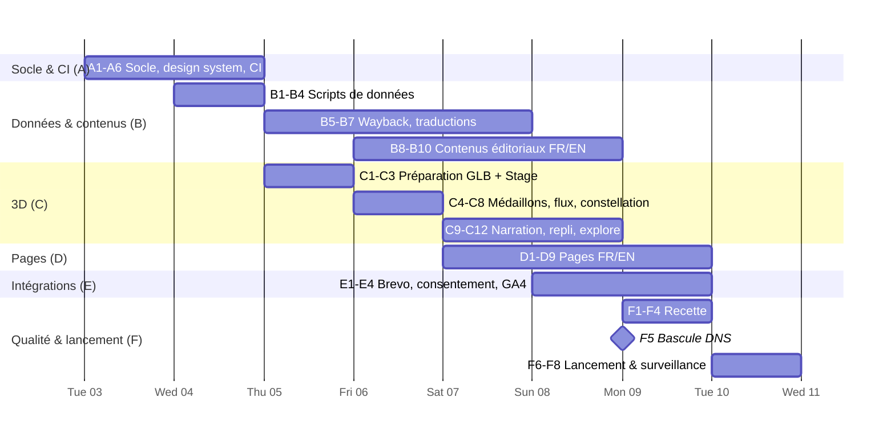

# Workflow d'implémentation — site ekylibre.com

> Entrées : `docs/brainstorm/01-exigences-site-ekylibre.md` (v3) · `docs/design/02-architecture.md`
> Fenêtre : **mardi 2026-11-03 (J0, après-midi) → mardi 2026-11-10 (J7, mise en ligne)**
> Stratégie : **systématique, par tranches verticales**. Chaque soir, le site est déployable sur l'URL de recette GitHub Pages.
> Ce document est un **plan** : aucune tâche n'est exécutée ici. Exécution avec `/sc:implement`, tâche par tâche ou jour par jour.

---

## 0. Hypothèses et décisions par défaut adoptées

Les décisions ouvertes au §13 de la conception sont réputées validées, faute d'objection avant le lancement du workflow :

1. Direction artistique « heure dorée numérique » ; polices Montserrat, Inter et JetBrains Mono.
2. Connecteurs en médaillons (schéma de flux de la doc) ; pictogrammes issus de la police `agric`.
3. **Vigne** : petit module de vigne **procédural** (rangs de piquets et de ceps, `InstancedMesh`) posé sur une parcelle maraîchère. Il ne passe pas par la chaîne de la maquette.
4. GA4 chargé **uniquement après consentement**.
5. **Bascule DNS : lundi 2026-11-09 au soir (J6).** Le TTL est abaissé dès J0.

**Rôles** : 🤖 = Claude (`/sc:implement`) · 👤 = David (données, accès, validations) · 🤝 = travail commun (relecture, arbitrage).

---

## 1. Vue d'ensemble



**Chemin critique** : A1 → A3 → C1 → C2 → C4/C5 → C9 → D1 (accueil) → F1 → F5 → F6.
La 3D est le poste le plus risqué : elle démarre dès J2 et dispose d'un jalon « minimum publiable » (CK-2).

---

## 2. Entrées attendues de David (👤) et échéances

| ID | Donnée / action | Requis pour | Échéance |
|---|---|---|---|
| U1 | **Abaisser le TTL DNS** d'`ekylibre.com` et `www` à 300 s | F5 | **J0 (aujourd'hui)** |
| U2 | Créer le dépôt public `ekylibre/ekylibre-sas` (ou confirmer l'organisation et le nom), activer Pages en mode « GitHub Actions » | A5 | J1 matin |
| U3 | Vérifier le domaine `ekylibre.com` dans les réglages de l'organisation GitHub (enregistrement TXT) | F5 | J3 |
| U4 | **ID de mesure GA4** (`G-…`) | E3 | J4 |
| U5 | **Brevo** : 3 listes (Démo, Projets, Newsletter) et attributs (§6.1 de la conception), ou un accès pour que Claude prépare le balisage des 6 formulaires FR/EN ; URL d'action | E1 | J4 |
| U6 | **Chiffres** : nombre d'exploitations, d'hectares, date de mesure | B9 | J5 |
| U7 | **Frise** : date de création d'Ekylibre SAS, corrections | B9 | J5 |
| U8 | **Mentions légales** : raison sociale, SIREN, siège, directeur de publication ; texte des CGU actuelles | B10 | J5 |
| U9 | Export du fichier `EKY QS - Chapters - Illustration FINALE.ai` en SVG ou PDF par scène (ou accord pour que Claude le convertisse avec Inkscape) | B8 | J3 |
| U10 | Relecture : textes FR (J5), scène 3D (CK-3, J4), recette finale (J6) | — | voir jalons |

**Comportement si une entrée manque** : U4 → site livré sans GA4, bandeau de consentement désactivé ; U6 → `StatBand` masque la valeur (déjà prévu) ; U8 → **bloquant** pour la mise en ligne (mentions obligatoires).

---

## 3. Tâches détaillées

Format : **ID** · description · rôle · durée estimée · dépendances · critère de fin (DoD).

### Piste A — Socle, design system, CI

| ID | Tâche | Rôle | Durée | Dépend de | Critère de fin |
|---|---|---|---|---|---|
| A1 | Initialiser Astro 7.4 (static, TypeScript strict), Tailwind 4.3, structure du dépôt (§3 de la conception), `.editorconfig`, Prettier, ESLint | 🤖 | 1 h | — | `npm run build` produit `dist/` ; arborescence conforme |
| A2 | i18n : `fr` à la racine, `en` sous `/en/`, `src/i18n/{fr,en}.ts`, table des slugs, composant `LangSwitch`, `hreflang` | 🤖 | 1,5 h | A1 | `/` et `/en/` répondent ; le sélecteur pointe vers la bonne page traduite |
| A3 | Design system : jetons `@theme` (§7.2), polices auto-hébergées (Fontsource → `public/fonts`, `preload`), échelle typographique fluide, sections claires et sombres, vérification des contrastes | 🤖 | 2,5 h | A1 | Page `/_styleguide` (non indexée) montrant jetons, typographie et boutons ; contrastes AA vérifiés |
| A4 | Sprite d'icônes : conversion de la police `agric` (MIT) en `public/icons/agric.svg`, composant `Icon`, sélection des glyphes (catégories et familles) | 🤖 | 1,5 h | A1 | Toutes les icônes de catégorie et de famille s'affichent en `currentColor` |
| A5 | CI : `.github/workflows/deploy.yml` (déclenchement sur push, cron du lundi, lancement manuel), `CNAME`, `base` configurable pour la recette | 🤖 | 1 h | A1, U2 | Déploiement vert ; site visible sur l'URL de recette |
| A6 | Layouts `Base`, `Page`, `Article` ; `Header` (menu, CTA démo), `Footer` (liens légaux, « Gérer les cookies », emplacement newsletter) ; SEO de base (titre, description, OpenGraph, canonical) | 🤖 | 2 h | A2, A3 | Header et footer responsives, navigation au clavier, FR et EN |

### Piste B — Données et contenus

| ID | Tâche | Rôle | Durée | Dépend de | Critère de fin |
|---|---|---|---|---|---|
| B1 | `scripts/fetch-plugins.mjs` : organisation GitHub → plugins stables (au moins un tag), `stats.json` ; validation Zod ; repli sur l'instantané | 🤖 | 2 h | A1 | 10 plugins stables listés au 2026-11-03 ; coupure réseau simulée → build vert avec avertissement |
| B2 | `scripts/fetch-lexicon.mjs` : `catalog.json` → `datasets.json`, chiffres agrégés | 🤖 | 1 h | A1 | 54 jeux, 623 M de lignes, nombre de fournisseurs calculé |
| B3 | `src/data/connectors.yaml` (10 plugins stables + entrées préparées pour les non-stables), `lexicon-families.yaml` (54 jeux → 7 familles, libellés FR/EN) | 🤖 | 2,5 h | B1, B2 | `check-content` : aucun plugin ni jeu orphelin |
| B4 | `scripts/check-content.mjs` : traductions manquantes, ancres inconnues, cibles de redirection, liens internes | 🤖 | 1,5 h | B3, A2 | Le build échoue sur une anomalie volontairement introduite |
| B5 | `scripts/import-wayback.mjs` : environ 30 anciennes actualités → `src/content/news/fr/*.md` (titre, date, texte, images téléchargées dans `src/assets/news/`, `legacyUrl`) | 🤖 | 3 h | A1 | Tous les articles importés ; relecture rapide du rendu ; images manquantes → couverture par défaut |
| B6 | `src/data/redirects.yaml` (dont les 3 articles retirés le 2026-11-03 → `/actualites/` : `des-solutions-connectees-…`, `formation-la-comptabilite-…-7-11-19`, `clic-and-farm-sia-2018`) : 129 URL → cibles (correspondances du §10 des exigences + `legacyUrl` des articles) | 🤖 | 1,5 h | B5, D-routes | `check-content` : 129 sur 129 avec une cible |
| B7 | Traduction EN des anciennes actualités (D17) | 🤖 | 3 h | B5 | 30 articles EN avec `translationKey` ; **coupable** (§6) |
| B8 | Illustrations isométriques : export du `.ai` en SVG/WebP par scène, optimisation (SVGO, `astro:assets`) | 🤖/👤 | 1,5 h | U9 | 6 visuels ou plus prêts (bureau, élevage, marché, 3 bandeaux de support), moins de 150 Ko chacun |
| B9 | `timeline.yaml`, `figures.yaml` | 🤖 | 0,5 h | U6, U7 | Frise et chiffres affichés |
| B10 | Contenus éditoriaux FR puis EN : 3 produits, 5 services, Développeurs, Entreprise, Interopérabilité, chapitres de l'accueil, pages légales | 🤖 → 👤 relecture | 6 h | A6, U8 | Relecture de David faite (J5) ; EN complet |

### Piste C — Scène 3D « La ferme connectée »

| ID | Tâche | Rôle | Durée | Dépend de | Critère de fin |
|---|---|---|---|---|---|
| C1 | `scripts/prepare-3d.mjs` (gltf-transform) : fusion terrain, contexte, REBUS (enveloppe), paysage et arbres ; décimation ; texture en KTX2 ; Meshopt ; sortie `hero.glb` (≤ 2,5 Mo) et `farm-full.glb` (≤ 5 Mo) ; `scene.json` enrichi (poids, provenance) ; décodeurs dans `public/3d/` | 🤖 | 3 h | A1 | Budgets respectés (le script échoue au-delà) ; les 2 GLB s'ouvrent dans un visualiseur glTF |
| C2 | Îlot `farm-scene` : `QualityTier`, `Stage` (rendu à la demande, pause hors écran), `AssetLoader` (Draco, Meshopt, KTX2), `FarmLayer` (lumière dorée, brouillard, arbres instanciés selon le tier), poster AVIF + fondu sur `eky:ready` | 🤖 | 4 h | C1, A3 | Ferme affichée sur l'accueil de recette ; poster puis fondu ; 60 images/s sur bureau, au moins 30 sur mobile récent |
| C3 | Zones et ancres : relevé `bat1…13` ↔ usages (gpkg), clé `zones` dans `scene.json`, `AnchorRegistry` ; **nouvelles vues caméra** (`parcelles`, `elevage-vigne`, `hub`, `ciel`, `cour`) | 🤖 | 2 h | C2 | Toutes les zones de la conception (§8.3) positionnées ; captures des 7 vues |
| C4 | `ConnectorLayer` : médaillons face à la caméra (anneau émissif, glyphe `agric`), fil vers le sol, étiquettes CSS2D en `<button>`, survol et sélection → `eky:select` | 🤖 | 3 h | C3, A4, B3 | 10 médaillons ; accessibles au clavier ; fiche ouverte au clic |
| C5 | `FlowLayer` : arcs `CatmullRomCurve3` vers le `hub`, `Line2` + shader de paquets, 2 verts selon le sens des flux | 🤖 | 2,5 h | C3 | Flux animés ; statiques en mode de mouvement réduit |
| C6 | `ConstellationLayer` : 7 amas, un point par jeu de données (`InstancedMesh`), médaillon de famille, filaments vers le `hub`, survol | 🤖 | 2,5 h | C3, B3 | 54 points ; infobulle de famille |
| C7 | Module **vigne procédural** (rangs instanciés) sur la zone `vigne-chai` | 🤖 | 1 h | C3 | Vigne lisible depuis la vue `elevage-vigne` ; moins de 50 Ko de géométrie |
| C8 | `PostFX` (bloom sélectif, tier `high` seulement) + `InfoCard` (DOM accessible, `Échap`, focus restitué) | 🤖 | 2 h | C4 | Bloom sur les médaillons et les flux uniquement ; fiche conforme au §8.7 |
| C9 | Îlot `scroll-story` : GSAP ScrollTrigger + Lenis, scène fixée, 7 chapitres → `eky:chapter` → `CameraDirector` | 🤖 | 4 h | C3–C6, B10 (textes provisoires possibles) | Défilement fluide aller et retour, sans saut ; mobile vérifié |
| C10 | `Fallback2D` : poster + schéma SVG de médaillons (style schéma de flux) + pastilles ; déclenché par le tier `none`, un échec ou un délai de plus de 8 s | 🤖 | 2 h | A4, B3 | Test Playwright avec WebGL désactivé → repli affiché, contenu complet |
| C11 | Mode `explore` (page Interopérabilité) : orbite bornée, boutons de vues, filtres `eky:filter`, recherche de connecteur | 🤖 | 2,5 h | C4–C8 | Filtres synchronisés avec `ConnectorGrid` et `DatasetTable` |
| C12 | Duke : clin d'œil dans le chapitre 5 (sprite discret) et page 404 | 🤖 | 0,5 h | C9, D9 | Visible sans gêner la lecture |

### Piste D — Pages (FR et EN)

| ID | Page / composants | Rôle | Durée | Dépend de | Critère de fin |
|---|---|---|---|---|---|
| D1 | **Accueil** : `Hero3D`, chapitres, `StatBand`, `ProductCard` ×3, aperçu des services, CTA | 🤖 | 3 h | C2, C9, B1–B3 | Lighthouse mobile ≥ 90 (recette) ; LCP sur le poster |
| D2 | **Interopérabilité** : scène `explore`, `ConnectorGrid`, `DatasetTable` (tri, liens Lexicon), explications des standards et des API | 🤖 | 3 h | C11, B3 | Équivalence entre la scène et le HTML vérifiée |
| D3 | **Produits** ×3 (Ekylibre, Aiffel, Lexicon) : rôle d'Ekylibre SAS (D8), fonctionnalités avec pictogrammes bicolores, liens vers les sites des produits | 🤖 | 2,5 h | B10 | 6 pages (FR et EN) |
| D4 | **Services** : 5 services, illustrations isométriques, 3 temps (bandeaux de support), formulaire « projet » | 🤖 | 2 h | B8, B10, E1 | Page de conversion complète |
| D5 | **Développeurs** : API REST, `CodeSample` (curl Lexicon, configuration MCP), plugins, GitHub, licences, schéma SVG de médaillons | 🤖 | 2 h | B1–B3 | Exemples copiables ; liens valides |
| D6 | **Entreprise** : histoire, `Timeline`, valeurs (communs, open source, souveraineté), Data-Agri, chiffres | 🤖 | 1,5 h | B9 | — |
| D7 | **Actualités** : liste paginée, page article, `NewsArticle` JSON-LD | 🤖 | 1,5 h | B5, B7 | 30 articles accessibles ; anciennes URL redirigées |
| D8 | **Contact / démo** + pages légales (`/mentions-legales/`, `/terms-of-use/`, `/confidentialite/`, `/cookies/`) | 🤖 | 1,5 h | E1, U8 | Mentions complètes |
| D9 | 404 bilingue (Duke), `robots.txt`, sitemap i18n, JSON-LD `Organization` et `SoftwareApplication` ×3, images OpenGraph par page | 🤖 | 1,5 h | D1–D8 | Données structurées valides |

### Piste E — Intégrations

| ID | Tâche | Rôle | Durée | Dépend de | Critère de fin |
|---|---|---|---|---|---|
| E1 | `BrevoForm` : balisage des 6 formulaires restylé, champ piège, consentement, envoi progressif en `fetch` + repli HTML, messages localisés ; `brevo.yaml` | 🤖 | 2,5 h | U5, A3 | Envoi réel de test reçu dans chacune des 3 listes (FR et EN) ; double opt-in de la newsletter reçu |
| E2 | Bandeau de consentement (vanilla-cookieconsent 3.2, FR/EN, catégories `necessary` et `analytics`, lien « Gérer les cookies ») | 🤖 | 1,5 h | A6 | Refus aussi simple que l'acceptation ; choix conservé 6 mois |
| E3 | GA4 après consentement uniquement : `consent default denied` → chargement de `gtag` après accord ; événements `generate_lead`, `scene_interaction`, `outbound_click` | 🤖 | 1,5 h | E2, U4 | Playwright : 0 requête Google avant accord ; événements visibles dans GA4 DebugView |
| E4 | CSP en `<meta>` + vérification qu'aucune ressource tierce n'est chargée hors Brevo et GA4 | 🤖 | 0,5 h | E1–E3 | Console sans violation CSP |

### Piste F — Qualité, mise en ligne, suivi

| ID | Tâche | Rôle | Durée | Dépend de | Critère de fin |
|---|---|---|---|---|---|
| F1 | Tests Playwright : fumée de toutes les routes FR et EN, axe-core (0 violation sérieuse ou critique), repli 3D, consentement, redirections (échantillon de 20 + les 129 en vérification statique) | 🤖 | 3 h | D*, E* | CI verte |
| F2 | Lighthouse CI (accueil, Interopérabilité, Services ; mobile) avec budgets (§9 de la conception) | 🤖 | 1 h | D1, D2, D4 | Performance ≥ 90, accessibilité ≥ 95, SEO ≥ 95, bonnes pratiques ≥ 95 |
| F3 | Recette multi-navigateurs : Chrome, Firefox, Safari (macOS et iOS), Android Chrome ; mobile bas de gamme (tier `low`) | 🤝 | 2 h | F1 | Grille de recette signée |
| F4 | Relecture finale FR/EN, liens externes, mentions légales | 👤 | 2 h | B10, D8 | Validation explicite de David |
| F5 | **Bascule DNS (J6 au soir)** : A ×4 / AAAA ×4 à l'apex, CNAME `www` → `ekylibre.github.io` ; domaine personnalisé dans Pages ; `base` = `/` | 👤 + 🤖 | 0,5 h + propagation | U1, U3, F1–F4 | `dig` correct ; certificat émis ; « Enforce HTTPS » coché |
| F6 | Vérifications après bascule : HTTPS, `www` → apex, 129 redirections en production, formulaires, GA4 temps réel | 🤖 | 1 h | F5 | Rapport de vérification |
| F7 | Google Search Console : propriété de domaine, envoi du sitemap, inspection de l'accueil FR et EN | 👤 | 0,5 h | F6 | Sitemap accepté |
| F8 | Surveillance J7 à J+7 : erreurs 404 (Search Console), envois Brevo, Core Web Vitals ; liste des corrections | 🤝 | — | F6 | Bilan à J+7 |

---

## 4. Planning jour par jour

| Jour | Date | Objectif du jour | Tâches | Jalon de fin de journée |
|---|---|---|---|---|
| **J0** | mar. 03/11 (après-midi) | Démarrage | U1 (TTL), A1 | Dépôt initialisé |
| **J1** | mer. 04/11 | Socle déployé | A2, A3, A4, A5, A6, B1, B2 | **CK-1** : site squelette FR/EN en ligne en recette, design system visible |
| **J2** | jeu. 05/11 | Données + 3D de base | B3, B4, B5 (lancé), C1, C2, C3 | **CK-2 « minimum publiable 3D »** : ferme + poster + vues caméra sur l'accueil de recette |
| **J3** | ven. 06/11 | Scène interopérable | C4, C5, C6, C7, C8, B5 (fin), B8, B10 (FR, début) | Médaillons, flux, constellation, vigne |
| **J4** | sam. 07/11 | Narration + pages | C9, C10, D1, D2, B6, B10 (FR) | **CK-3** : revue de la scène et de l'accueil par David |
| **J5** | dim. 08/11 | Pages + intégrations | C11, C12, D3–D8, E1–E4, B9, B10 (EN), B7 | **CK-4** : contenus FR relus par David ; toutes les pages existent en FR et en EN |
| **J6** | lun. 09/11 | Recette + bascule | D9, F1, F2, F3, F4 ; **F5 le soir** | **CK-5** : go / no-go à 18 h ; DNS basculé |
| **J7** | mar. 10/11 | **Lancement** | F6, F7, corrections, annonce | **CK-6** : ekylibre.com en ligne, vérifications passées |

> J4 et J5 tombent un week-end : ce plan suppose que David est disponible pour CK-3 (samedi) et CK-4 (dimanche). Sinon, décaler les relectures au lundi matin et réduire le périmètre selon le §6.

---

## 5. Jalons et critères de passage

| Jalon | Critères | Si le jalon n'est pas atteint |
|---|---|---|
| **CK-1** (J1) | Build et déploiement verts ; `/` et `/en/` ; jetons AA ; icônes `agric` | Bloquer les pistes C et D tant que la CI ne fonctionne pas |
| **CK-2** (J2) | `hero.glb` ≤ 2,5 Mo ; scène ≥ 30 images/s sur mobile récent ; poster LCP ; tier `none` → repli | Baisser la résolution du terrain et réduire les arbres ; au pire, le hero devient un **poster seul + schéma SVG** (pas de vidéo en lecture automatique, ENF8) |
| **CK-3** (J4) | Narration fluide aller et retour ; 10 médaillons ; constellation ; validation visuelle par David | Retirer la narration (orbite lente et chapitres en texte simple) et garder la scène statique interactive |
| **CK-4** (J5) | 100 % des pages de lancement en FR et EN ; formulaires Brevo testés ; consentement conforme | Activer les coupes du §6 |
| **CK-5** (J6, 18 h) | F1 et F2 verts ; F4 validé ; mentions légales complètes | **No-go** : maintenir l'ancien DNS (le site est hors ligne de toute façon) et basculer J7 au matin avec un périmètre réduit |
| **CK-6** (J7) | HTTPS, redirections, formulaires, GA4 vérifiés en production | Corriger en continu ; un retour arrière n'est pas nécessaire (pas d'ancien site à restaurer) |

---

## 6. Périmètre coupable (dans cet ordre si le temps manque)

1. B7 — traduction EN des anciennes actualités → articles marqués « FR uniquement » (exception dans `check-content`).
2. C11 — mode `explore` complet → la page Interopérabilité garde la scène du hero avec boutons de vues, sans filtres.
3. C8 — post-traitement (bloom) → émissif seul.
4. C7 — vigne procédurale → médaillons Ekyviti et Baqio placés sur les parcelles, sans géométrie.
5. C9 — narration → orbite lente + chapitres en sections classiques.
6. D7 — page Actualités → reportée à J+7 (les redirections des articles pointent provisoirement vers `/actualites/`).

**Non coupables** : mentions légales, consentement et GA4, formulaires Brevo, redirections, bilinguisme des pages principales, repli 2D, accessibilité.

---

## 7. Parallélisation (exécution par Claude)

- **J1** : A3 et A4 en parallèle de B1 et B2 (pas de dépendance mutuelle).
- **J2** : B5 (import Wayback, long et lié au réseau) en tâche de fond pendant C1 à C3.
- **J3** : C4, C5 et C6 partagent `AnchorRegistry` mais sont indépendants entre eux, donc parallélisables ; B10 (rédaction) dans un fil séparé.
- **J5** : D3 à D8 sont des pages indépendantes, parallélisables ; E1 à E4 se suivent.
- Revue de code (`/code-review`) à la fin de J2 (îlot 3D), de J4 (narration) et de J5 (intégrations, sécurité et RGPD).

---

## 8. Stratégie de validation

| Niveau | Outil | Quand |
|---|---|---|
| Schémas de données | Zod (`fetch-*`, collections) | À chaque build |
| Cohérence des contenus | `check-content` (traductions, ancres, redirections, liens) | À chaque build |
| Rendu et parcours | Playwright (fumée, repli WebGL, consentement, formulaires simulés) | CI, chaque push |
| Accessibilité | axe-core via Playwright, navigation au clavier manuelle sur la scène | CI + CK-3, CK-5 |
| Performance | Lighthouse CI avec budgets ; rapport de taille des paquets JS | CI (J4 →) |
| Budgets 3D | `prepare-3d` (poids) ; mesure des images/s avec `stats.js` en mode debug | C1, CK-2 |
| Conformité RGPD | Playwright « aucune requête Google avant accord » ; revue du bandeau | E3, CK-5 |
| Production | Script de vérification après bascule (HTTPS, 129 redirections, en-têtes, sitemap) | F6 |

---

## 9. Risques suivis pendant l'exécution

| Risque | Signal d'alerte | Parade |
|---|---|---|
| 3D trop lourde ou lente | CK-2 non atteint | §5 CK-2, coupes du §6 |
| Week-end sans relecture | CK-3 ou CK-4 sans retour de David | Relecture groupée lundi 9 h ; Claude relit en croisé FR/EN |
| Brevo non configuré à J4 | U5 manquant | Formulaires livrés avec le balisage prêt, branchés dès réception |
| Mentions légales manquantes | U8 manquant à J5 | **Bloquant pour CK-5** : relance J5 matin |
| Certificat HTTPS lent | Certificat non émis 2 h après la bascule | Bascule J6 au soir (marge d'une nuit) ; « Enforce HTTPS » coché seulement une fois le certificat émis |
| Images manquantes dans la Wayback Machine | Erreurs d'import B5 | Couverture par défaut ; texte conservé |

---

## 10. Démarrage

```text
/sc:implement A1        # J0 : initialisation du dépôt Astro
/sc:implement J1        # ou jour par jour : A2–A6, B1, B2
```

**Action immédiate pour David (U1)** : abaisser le TTL DNS d'`ekylibre.com` à 300 s **aujourd'hui**.
