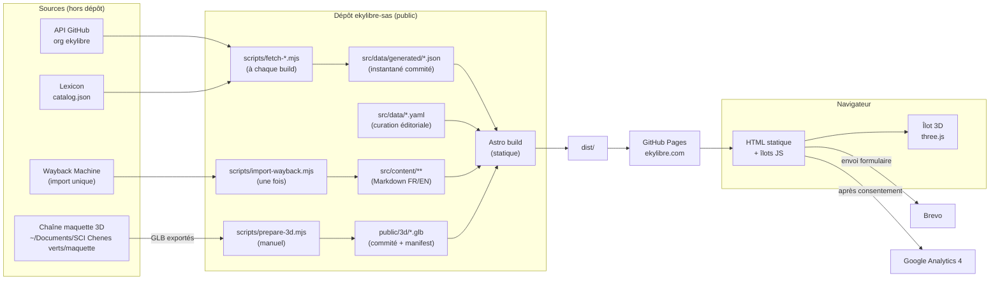
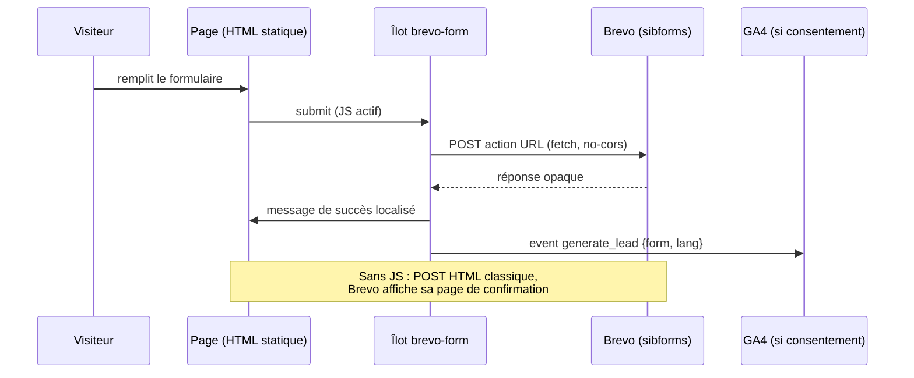
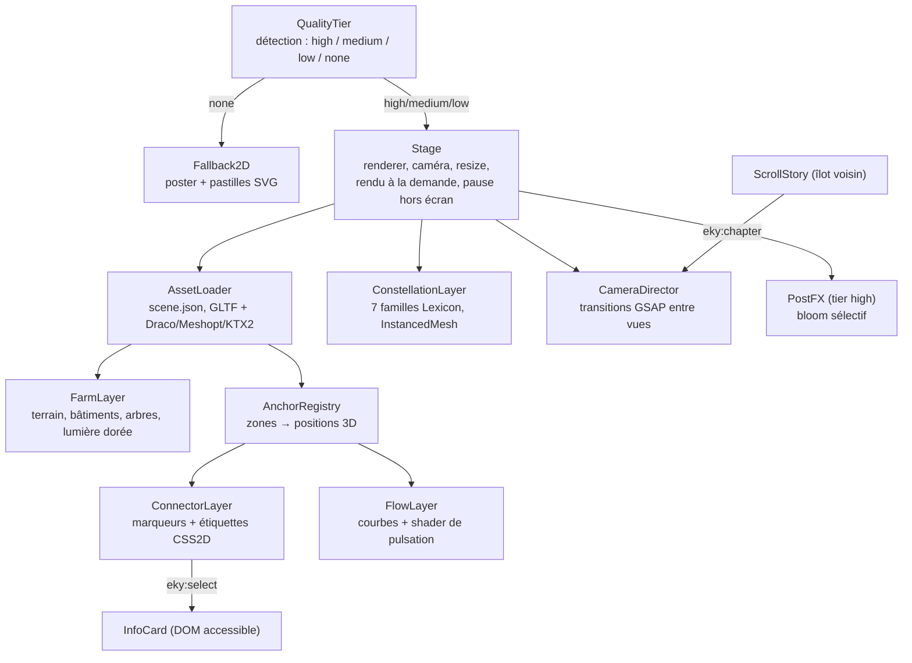
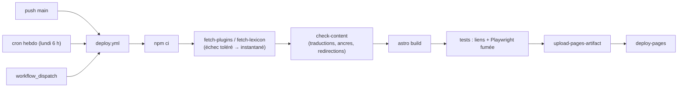

# Site ekylibre.com — Conception (architecture, données, design system, scène 3D)

> Statut : **proposition à valider**, 2026-11-03. Entrée : `docs/brainstorm/01-exigences-site-ekylibre.md` (v3, décisions D1 à D18).
> Sortie : base de `/sc:workflow` (plan sur 7 jours), puis `/sc:implement`.
> Ce document fixe les **choix, structures, contrats et budgets**. Il ne contient pas de code d'implémentation : les blocs « type » sont des contrats d'interface.

---

## 1. Vue d'ensemble



**Principes**
1. **Statique d'abord** : chaque page est du HTML complet et lisible sans JavaScript. Le JavaScript se limite à quatre îlots : scène 3D, défilement scénarisé, formulaires, consentement.
2. **Données vivantes, build robuste** : GitHub et Lexicon sont interrogés à chaque build. En cas d'échec, le build continue avec l'**instantané commité** et émet un avertissement, sans échouer.
3. **Le site consomme la 3D, il ne la fabrique pas** : la chaîne FreeCAD/Blender reste dans le dépôt de la maquette. Le site reçoit des GLB optimisés, accompagnés d'un manifeste de provenance.
4. **Séparer données factuelles et éditoriales** : les faits (plugins, versions, jeux de données, chiffres) sont générés ; les textes, placements et traductions sont curés en YAML et en Markdown.

---

## 2. Choix techniques (ADR résumés)

| # | Décision | Alternatives écartées | Raison |
|---|---|---|---|
| ADR-1 | **Astro 7.4** en sortie `static` | Next.js en export statique, Jekyll, Hugo | HTML pur par défaut, îlots, i18n natif, collections typées (Zod), écosystème Vite ; adapté à Pages |
| ADR-2 | **three.js 0.187 en JS/TS natif**, empaqueté par Vite | React Three Fiber, Babylon.js, Spline | Reprise directe de la visionneuse OSFarm (même format `scene.json`), pas de React (environ 45 Ko économisés), contrôle fin de la boucle de rendu |
| ADR-3 | **TypeScript strict** pour les îlots et les scripts | JS | Contrats de données partagés entre build et navigateur |
| ADR-4 | **Tailwind CSS 4.3** (`@tailwindcss/vite`) + jetons CSS (`@theme`) | CSS Modules, UnoCSS | Design system en variables CSS, rapide à écrire en 7 jours |
| ADR-5 | **GSAP 3.15 + ScrollTrigger**, **Lenis 1.3** | Animations CSS au défilement seules | Pilotage de la caméra 3D synchronisé au défilement ; GSAP gratuit pour tous usages |
| ADR-6 | **GLB commités** dans `public/3d/` (environ 6 Mo) | Git LFS, CDN externe | Pages ne sert pas les fichiers LFS ; un poids modeste reste acceptable dans Git |
| ADR-7 | **Redirections par pages HTML générées** (`redirects` d'Astro → `meta refresh` + `canonical`) | Redirections serveur (impossibles sur Pages), Cloudflare | Zéro infrastructure ; Google traite le `meta refresh` 0 s comme une redirection permanente |
| ADR-8 | **GA4 + Consent Mode v2** derrière **vanilla-cookieconsent 3.2** | Plausible, bandeau maison | Décision D16 ; bibliothèque open source et auto-hébergée |
| ADR-9 | **Formulaires Brevo intégrés**, balisage restylé | Formspree, API Brevo appelée par le navigateur | Aucune clé exposée ; double opt-in et RGPD gérés par Brevo |
| ADR-10 | **Médaillons de connecteurs** dans le langage du « schéma de flux » de la documentation Ekylibre (anneau vert, pictogramme au centre), affichés en 3D face à la caméra ; pas de nouveaux modèles réalistes | Hexagones holographiques génériques ; modéliser tracteur, station météo… dans Blender | Continuité avec l'iconographie existante (§7.5), tient le délai, poids quasi nul |
| ADR-11 | **Pictogrammes : police `agric` (MIT, github.com/ekylibre/agric) convertie en sprite SVG**, complétée par Lucide (ISC) pour l'interface | Réutiliser les PNG du hero de la documentation | Licence claire, vectoriel net à toutes les tailles, colorable en CSS |

---

## 3. Structure du dépôt

```
ekylibre-sas/
├─ astro.config.mjs            # i18n, redirects (depuis data/redirects.yaml), sitemap, site=https://ekylibre.com
├─ public/
│  ├─ CNAME                    # ekylibre.com
│  ├─ 3d/
│  │  ├─ hero.glb              # scène allégée (accueil)
│  │  ├─ farm-full.glb         # scène complète (page Interopérabilité)
│  │  ├─ scene.json            # manifeste : repère, vues caméra, ancres, provenance, poids
│  │  ├─ poster-hero.avif|webp # image d'attente (rendu Blender, 1600 et 2400 px)
│  │  └─ draco/, basis/        # décodeurs auto-hébergés (Draco, KTX2)
│  ├─ fonts/                   # woff2 auto-hébergées
│  └─ og/                      # images OpenGraph par page et par langue
├─ scripts/
│  ├─ fetch-plugins.mjs        # GitHub → generated/plugins.json + generated/stats.json
│  ├─ fetch-lexicon.mjs        # catalog.json → generated/datasets.json
│  ├─ prepare-3d.mjs           # gltf-transform : GLB maquette → public/3d (lancé à la main)
│  ├─ import-wayback.mjs       # anciennes actualités → src/content/news/fr/*.md (une seule fois)
│  └─ check-content.mjs        # contrôle des traductions manquantes, ancres inconnues, liens
├─ src/
│  ├─ content.config.ts        # schémas Zod des collections
│  ├─ content/
│  │  ├─ news/{fr,en}/*.md
│  │  ├─ products/{fr,en}/{ekylibre,aiffel,lexicon}.md
│  │  ├─ services/{fr,en}/*.md
│  │  └─ legal/{fr,en}/{mentions,cgu,confidentialite,cookies}.md
│  ├─ data/
│  │  ├─ generated/            # instantanés JSON commités, écrasés par fetch-*
│  │  ├─ connectors.yaml       # curation des plugins : zone, catégorie, partenaire, textes FR/EN
│  │  ├─ lexicon-families.yaml # 54 jeux → 7 familles + libellés FR/EN
│  │  ├─ timeline.yaml         # dates clés FR/EN
│  │  ├─ figures.yaml          # chiffres fournis (exploitations, hectares, date de mesure)
│  │  ├─ redirects.yaml        # 129 anciennes URL → nouvelles
│  │  └─ brevo.yaml            # URL d'action des formulaires par usage et par langue
│  ├─ i18n/{fr,en}.ts          # libellés d'interface et table des slugs traduits
│  ├─ layouts/                 # Base, Page, Article
│  ├─ components/              # composants Astro (§7.4)
│  ├─ islands/
│  │  ├─ farm-scene/           # îlot 3D (§8)
│  │  ├─ scroll-story/         # narration au défilement (§8.6)
│  │  ├─ brevo-form/           # amélioration progressive des formulaires
│  │  └─ consent/              # bandeau + Consent Mode
│  ├─ pages/                   # routes (§5)
│  └─ styles/global.css        # @theme : jetons du design system
├─ tests/                      # Playwright (fumée, accessibilité, repli 3D)
└─ .github/workflows/deploy.yml
```

---

## 4. Modèle de données

### 4.1 Données générées (contrats)

```ts
// src/data/generated/plugins.json
type Plugin = {
  repo: string;              // "ekylibre-samsys"
  slug: string;              // "samsys"
  latestTag: string;         // "0.7.0"  — critère de stabilité (D9)
  pushedAt: string;          // ISO
  commits: number;
  license: string | null;    // SPDX depuis l'API GitHub
  url: string;
  readmeSummary: string;     // 1re phrase du README (secours si pas de curation)
};

// src/data/generated/stats.json
type Stats = {
  generatedAt: string;
  core: { firstCommit: string; commits: number; contributors: number; stars: number; forks: number };
  stablePlugins: number;
  lexicon: { items: number; datasets: number; providers: number; byEkylibre: number };
};

// src/data/generated/datasets.json   (projection de catalog.json)
type Dataset = {
  name: string; provider: string; licence: string; licenceUrl?: string;
  scope: "open" | "members"; rows: number; sourceDate?: string; sourceUrl?: string;
  version: string; href: string;     // lien vers lexicon.osfarm.org/catalog/<name>
};
```

**Règles de génération**
- Plugin **stable** = dépôt `ekylibre-*`, non archivé, avec au moins un tag (D9). Le dépôt cœur `ekylibre` et les dépôts techniques (`active_list`, `onoma`…) sont exclus par une liste blanche de préfixes.
- `fetch-*` valide les données avec Zod. En cas d'échec (réseau, quota GitHub, schéma), l'instantané est conservé et le script affiche `::warning::` dans GitHub Actions.
- Authentification GitHub : `GITHUB_TOKEN` du workflow (quota de 5 000 requêtes/h).

### 4.2 Données curées

```ts
// src/data/connectors.yaml — une entrée par plugin à afficher
type Connector = {
  slug: string;                       // = Plugin.slug
  partner?: { name: string; url: string; logo?: string };   // Samsys, Weenat, Baqio…
  category: "machines" | "meteo" | "elevage" | "vigne" | "finance" | "gestion" | "durabilite" | "terrain";
  zone: ZoneId;                       // ancre dans la scène (§8.3)
  title: { fr: string; en: string };
  summary: { fr: string; en: string };
  dataFlow: "in" | "out" | "both";    // sens des flux, utile pour les DSI (US1)
};
```
- Un plugin stable **sans** entrée YAML est affiché dans la liste avec son résumé README, placé dans la zone `bureau`, et `check-content` le signale.
- Une entrée YAML **sans** plugin stable n'est pas affichée (D9). Elle apparaîtra automatiquement dès qu'une version sera publiée.

```ts
// src/data/lexicon-families.yaml
type Family = {
  id: "territoire" | "climat" | "intrants" | "entreprises" | "marches" | "savoirs" | "filiere";
  title: { fr: string; en: string }; color: string;   // jeton du design system
  datasets: Record<string /*name*/, { fr: string; en: string }>;  // 54 libellés traduits
};
// Un jeu de données absent de toutes les familles → famille "divers" + avertissement au build.
```

`timeline.yaml` (`date`, `title{fr,en}`, `text{fr,en}`, `source`) ; `figures.yaml` (`farms`, `hectares`, `measuredAt`, `source`) ; `redirects.yaml` (`from` → `to`, avec `lang`).

### 4.3 Collections de contenu (Markdown)

| Collection | Champs du frontmatter | Remarques |
|---|---|---|
| `news` | `title`, `date`, `lang`, `translationKey`, `summary`, `cover?`, `legacyUrl?`, `tags[]` | Anciens articles importés avec `legacyUrl` → redirection automatique (D15) |
| `products` | `name`, `tagline`, `url`, `role` (« éditeur et opérateur »…), `features[]`, `cta` | 3 fiches × 2 langues |
| `services` | `title`, `order`, `icon`, `deliverables[]` | Intégration, formation, transformation du SI, connecteurs, support |
| `legal` | `title`, `updatedAt` | — |

Le lien entre les versions FR et EN se fait par **`translationKey`** (sélecteur de langue, `hreflang`). `check-content` fait échouer le build s'il manque une traduction sur une page de la version de lancement.

---

## 5. Routes et internationalisation

Configuration i18n d'Astro : `locales: ["fr","en"]`, `defaultLocale: "fr"`, `prefixDefaultLocale: false` → le français à la racine, l'anglais sous `/en/`.

| Page | FR | EN | Îlots |
|---|---|---|---|
| Accueil | `/` | `/en/` | scène 3D (hero), narration au défilement, formulaire newsletter |
| Interopérabilité | `/interoperabilite/` | `/en/interoperability/` | scène 3D complète + filtres |
| Produits | `/ekylibre/`, `/aiffel/`, `/lexicon/` | `/en/ekylibre/`… | — |
| Services | `/services/` | `/en/services/` | formulaire « projet » |
| Développeurs | `/developpeurs/` | `/en/developers/` | — |
| Entreprise | `/entreprise/` | `/en/company/` | — |
| Actualités | `/actualites/`, `/actualites/[slug]/` | `/en/news/`… | — |
| Contact / démo | `/contact/` | `/en/contact/` | formulaire « démo » |
| Légal | `/mentions-legales/`, `/terms-of-use/` (CGU, URL conservée), `/confidentialite/`, `/cookies/` | `/en/legal-notice/`, `/en/terms-of-use/`… | — |
| 404 | `/404.html` | (même page, bilingue) | — |

- Les slugs traduits viennent de `src/i18n/*.ts`. Le sélecteur de langue utilise la table des correspondances, et non une simple substitution de préfixe.
- `hreflang` fr / en / x-default sur chaque page ; sitemap i18n avec `@astrojs/sitemap`.

**Redirections** : `redirects.yaml` est injecté dans la clé `redirects` d'`astro.config` et produit 129 pages `meta refresh`. Correspondances : voir §10 du document d'exigences. Les anciens articles redirigent vers leur nouvelle URL grâce à `legacyUrl`. `check-content` vérifie que chacune des 129 URL a une cible.

---

## 6. Interfaces externes

### 6.1 Brevo (formulaires)



| Formulaire | Pages | Attributs Brevo | Liste | Opt-in |
|---|---|---|---|---|
| `demo` | Contact, CTA produits | `PRENOM`, `NOM`, `EMAIL`, `ENTREPRISE`, `PROFIL` (agriculteur / coop-OPA / éditeur / autre), `LANGUE`, `PAGE_SOURCE` | Démo | simple + case de consentement |
| `projet` | Services | ci-dessus + `MESSAGE`, `SERVICE` (liste) | Projets | simple + case de consentement |
| `newsletter` | Pied de page | `EMAIL`, `LANGUE` | Newsletter | **double opt-in** |

- 2 versions par formulaire (FR et EN), soit 6 URL d'action dans `brevo.yaml`.
- Anti-spam : champ piège (honeypot) de Brevo, plus le captcha Brevo si nécessaire.
- Le formulaire n'envoie **rien** à GA4 sans consentement.

### 6.2 Consentement et GA4

- Le bandeau (vanilla-cookieconsent) propose deux catégories : `necessary` (toujours active, ne contient aucun cookie de mesure) et `analytics`.
- Dans le `<head>` : `gtag('consent','default',{analytics_storage:'denied', ad_storage:'denied', ad_user_data:'denied', ad_personalization:'denied'})`, puis le script GA4.
  - **Choix recommandé** : *advanced consent mode* désactivé, c'est-à-dire que **le script GA4 n'est pas chargé avant l'accord**. C'est l'option la plus sûre au regard de la CNIL.
- Après accord : `consent update` + chargement de `gtag.js` avec l'ID depuis `PUBLIC_GA4_ID`.
- Événements : `page_view` (automatique), `generate_lead`, `scene_interaction` (sélection d'un connecteur), `outbound_click` (démo, GitHub, aiffel, lexicon).
- Le lien « Gérer les cookies » du pied de page rouvre les préférences. Le consentement est conservé 6 mois.

### 6.3 GitHub et Lexicon (au build)
- GitHub : `GET /orgs/ekylibre/repos?per_page=100` (pagination), `GET /repos/{r}/tags?per_page=1`, nombre de commits par l'en-tête `Link`, `GET /repos/ekylibre/ekylibre` + contributeurs.
- Lexicon : `GET https://lexicon.osfarm.org/catalog.json` → champs `items-count` et `datasets[]` (`name`, `provider`, `licence`, `scope`, `rows`, `source-date`, `href`…).

---

## 7. Design system

### 7.1 Direction artistique
**« L'heure dorée numérique »** : la lumière rasante de la photo drone (fin de journée sur La Vauzelle) rencontre une couche de données lumineuse.
- Sections **sombres** (vert-nuit) pour la scène 3D, l'interopérabilité et les développeurs : registre technologique.
- Sections **claires** (crème, couleur de paille) pour les produits, les services, l'entreprise et les actualités : registre agricole et professionnel.
- Le vert Ekylibre reste la couleur d'action et de donnée « vivante » (D4).

### 7.2 Jetons

| Jeton | Valeur | Usage |
|---|---|---|
| `--eky-green` | `#00C15D` | Marque, CTA, flux de données |
| `--eky-green-light` | `#4ED164` | Survol, lueurs (bloom) |
| `--night-900` | `#07140E` | Fond des sections tech |
| `--night-700` | `#0F2A1E` | Cartes sur fond sombre |
| `--straw-50` | `#FAF6EC` | Fond des sections claires |
| `--wheat-400` | `#E2B76C` | Accent agricole, famille « marchés » (repris des illustrations de la doc) |
| `--ochre-400` | `#CE9558` | Bois, terre des illustrations isométriques |
| `--grass-500` | `#8DB44F` | Prairies des illustrations, famille « savoirs » |
| `--eky-green-deep` | `#008F46` | Flèches principales du schéma de flux, éléments graphiques et titres de grande taille sur fond clair (3,9:1, suffisant pour ces usages, pas pour du texte courant) |
| `--eky-green-text` | `#00703A` | Liens et texte vert courant sur fond clair (5,7:1 sur `--straw-50`, AA) |
| `--mint-100` | `#C3E0C6` | Aplat clair des pictogrammes bicolores de l'application |
| `--apricot-100` | `#FCD79E` | Aplat clair alternatif (pictogrammes « orange » de l'application) |
| `--clay-500` | `#C46A3C` | Accent (tuiles de la ferme), alertes douces |
| `--soil-800` | `#3A2C20` | Texte sur fond clair (plus chaud qu'un noir) |
| `--sky-300` | `#8EC5E8` | Famille « climat », eau |
| `--ink-500` | `#5B6B63` | Texte secondaire |

Les 7 couleurs des familles Lexicon sont dérivées de ces jetons (territoire = argile, climat = ciel, intrants = vert clair, entreprises = blanc cassé, marchés = blé, savoirs = vert Ekylibre, filière = rose terre). **Contrastes vérifiés AA** : le texte sur `--eky-green` est `--night-900`, jamais blanc (le blanc sur `#00C15D` donne un ratio de 2,4:1, insuffisant ; `--night-900` sur ce vert donne 7,8:1).

### 7.3 Typographie (auto-hébergée, woff2, sous-ensemble latin)
- **Titres** : *Montserrat* 600/700, pour la continuité avec la marque.
- **Texte** : *Inter* (variable), lisible et professionnelle.
- **Données et code** : *JetBrains Mono* : chiffres, noms de jeux de données, exemples d'API ; signal « tech ».
- Échelle fluide avec `clamp()`, de 16 px pour le texte à 72 px pour le titre de la page d'accueil. Interlignage 1,6 pour le texte.

### 7.4 Composants (Astro, sans JS sauf mention)
`Header` (menu, sélecteur de langue, CTA démo) · `Footer` (newsletter [îlot], liens légaux, « Gérer les cookies ») · `Hero3D` (poster + îlot scène) · `StatBand` (chiffres en police mono, animés au défilement) · `ProductCard` ×3 · `ServiceGrid` · `ConnectorGrid` (filtrable par catégorie, version tableau accessible) · `DatasetTable` (54 lignes, tri, lien vers le Lexicon) · `Timeline` · `NewsCard` / `NewsList` · `CodeSample` (curl, configuration MCP) · `CTASection` · `BrevoForm` [îlot] · `ConsentBanner` [îlot] · `LangSwitch`.

### 7.5 Iconographie (reprise de la documentation Ekylibre)

Source : `github.com/ekylibre/ekylibre.github.io` (illustrations de l'accueil de la documentation utilisateur, `illustrations/EKY QS - Chapters - Illustration FINALE.ai`, `public/images/hero/`, `images/commun/`). La documentation a déjà un langage visuel fort ; le site le prolonge au lieu d'en inventer un autre.

| Élément de la doc | Ce qu'on en tire pour le site | Où |
|---|---|---|
| **Illustrations isométriques** (bureau de l'agriculteur, élevage avec tracteur, vente en marché ; palette herbe `#8DB44F`, ocre `#CE9558`, crème `#EBE4B8`, blé `#E2B76C`) | **Isométrie = registre agricole du site.** Bandeaux des pages Services, Produits et Entreprise, illustrations des cartes de service, repli 2D de la scène. Les fichiers sources `.ai` permettent d'extraire des scènes (export SVG ou WebP). Le jeu de jetons (§7.2) est **aligné sur cette palette** | Sections claires |
| **Schéma de flux** (médaillons ronds à anneau vert contenant un objet isométrique ; libellé en gras au-dessus ; flèches orthogonales en deux verts, foncé et clair) | **Langage graphique de l'interopérabilité**, décliné en 3 formes : (1) les marqueurs 3D des connecteurs sont des médaillons (§8.4) ; (2) le repli 2D et la page Développeurs utilisent un schéma SVG de médaillons et de flèches orthogonales ; (3) les cartes `ConnectorGrid` ont une pastille-médaillon | Scène, Interopérabilité, Développeurs |
| **Glyphes agricoles monochromes** (tracteur, blé, vache, raisin, pousse, tournesol, arbre, graine…) — famille de la police **`agric`** | Pictogrammes de catégories (machines, météo, élevage, vigne…), icônes des 7 familles Lexicon, puces de listes ; motif décoratif « pictogrammes en suspension » dans les sections sombres (clin d'œil au hero PixiJS de la doc) | Partout |
| **Pictogrammes bicolores de l'application** (trait vert ou orange, aplat `#C3E0C6` ou `#FCD79E`) | Style des icônes de fonctionnalités Ekylibre (comptabilité, ventes, stocks…) sur la page produit, pour qu'elles ressemblent à ce que l'utilisateur verra dans l'application | Page Ekylibre |
| **Duke** (hibou, ancien assistant) — *validé* | Mascotte discrète, seulement sur la page 404 (« Duke n'a pas trouvé cette page ») et en petit clin d'œil dans le chapitre « La voix » de l'accueil. Aiffel reste la voix officielle | 404, chapitre 5 |
| **Bandeaux de support** (personnages au bureau : problème, accompagnement, satisfaction) | Illustrent les 3 temps de la page Services (« diagnostic → accompagnement → autonomie ») | Services |

**Règles**
- **Deux registres, sans mélange dans un même bloc** : isométrie colorée sur fond clair ; médaillons, glyphes et flux lumineux sur fond sombre.
- **Glyphes** : sprite SVG unique (`public/icons/agric.svg`) généré à partir de la police `agric` (MIT) ; couleur pilotée par `currentColor`. Les PNG du hero de la doc ne sont **pas** repris : provenance non vérifiée, et certains semblent issus de Font Awesome Pro, sous licence.
- **Droits** : les illustrations isométriques ont été **réalisées par Ekylibre** (confirmé le 2026-11-03) : réutilisation et déclinaison libres, à partir du fichier source `.ai`.
- **Isométrie et 3D** : la vue caméra d'ouverture de la scène utilise une focale longue (FOV 25°), en vue plongeante à environ 35°, pour rappeler l'isométrie des illustrations et faire le lien entre les deux registres.

### 7.6 Mouvement
- Durées de 200 à 600 ms ; courbe `power2.out`. Pas de parallaxe gratuite : le mouvement porte le récit, c'est-à-dire la caméra et les flux.
- Avec `prefers-reduced-motion` : Lenis désactivé, caméra en coupes franches entre chapitres, flux statiques, compteurs affichés directement.

---

## 8. Scène 3D « La ferme connectée » (îlot `farm-scene`)

### 8.1 Composition

| Calque | Source (maquette) | Hero | Interop | Traitement `prepare-3d` |
|---|---|---|---|---|
| Terrain + orthophoto | `terrain.glb` | ✓ (décimé à 50 %, texture 2048) | ✓ (texture 4096) | `simplify`, texture en **KTX2 (UASTC/ETC1S)**, `meshopt` |
| Bâtiments de la ferme | `contexte.glb` | ✓ | ✓ | conserver les `extras.label` (ancres) |
| REBUS (extérieur, projet) | `rebus_ESQ.glb` | ✓ (enveloppe seule) | ✓ | retirer l'intérieur et le mobilier |
| Clôtures, murets | `paysage.glb` | ✓ | ✓ | — |
| Arbres (2 622) | `arbres.glb` | ✓ (1 200 les plus proches) | ✓ | conserver l'instanciation (`EXT_mesh_gpu_instancing`) |
| Réseaux, mobilier, EDL | — | ✗ | ✗ | **exclus** (§1.3 des exigences) |
| Marqueurs, flux, constellation | procéduraux (code) | ✓ | ✓ | — |

> **Mise en œuvre (J2)** : sans `toktx` disponible, les textures sont en **WebP** (`EXT_texture_webp`) et la géométrie en **Meshopt** (`EXT_meshopt_compression`, décodeur embarqué dans three.js, aucun fichier WASM à héberger) plutôt que KTX2/Draco. Résultat : `hero.glb` 2,0 Mo, `farm-full.glb` 2,8 Mo.

**Budget** : `hero.glb` ≤ **2,5 Mo**, `farm-full.glb` ≤ **5 Mo**. `prepare-3d` fait échouer l'étape si le budget est dépassé, et écrit le poids réel dans `scene.json`.
**Repère** : celui de la maquette, conservé tel quel (local Lambert 93 − (406300, 6532400), Y vers le haut), ce qui permet de reprendre les vues et les ancres existantes.

### 8.2 Architecture de l'îlot



**Contrat d'entrée de l'îlot** (JSON sérialisé dans la page au build ; aucune requête de données au chargement) :

```ts
type FarmSceneProps = {
  mode: "hero" | "explore";
  lang: "fr" | "en";
  assets: { manifest: string; glb: string; poster: string };
  zones: Zone[];                      // §8.3
  connectors: Array<Pick<Connector,"slug"|"category"|"zone"|"dataFlow"> & { title: string; summary: string; url: string; partner?: string }>;
  families: Array<{ id: string; title: string; color: string; count: number; datasets: Array<{ name: string; label: string; provider: string; href: string }> }>;
  chapters?: Chapter[];               // hero uniquement, §8.6
  strings: Record<string,string>;     // libellés d'interface traduits
};
```

**Événements DOM** (`CustomEvent` sur `document`, préfixe `eky:`) :

| Événement | Émetteur → récepteur | Contenu |
|---|---|---|
| `eky:ready` | scène → page | `{ tier }` : masque le poster par un fondu |
| `eky:fallback` | scène → page | `{ reason }` : affiche la version 2D |
| `eky:chapter` | ScrollStory → scène | `{ id, progress }` |
| `eky:select` | scène → InfoCard et GA4 | `{ kind: "connector" \| "family" \| "dataset", id }` |
| `eky:filter` | filtres de la page → scène | `{ categories[], families[] }` (mode explore) |

### 8.3 Zones (ancres sur la ferme)

Zones déclarées dans `scene.json` (clé `zones`). Chacune est ancrée sur un objet glTF (`extras.label`) ou sur une coordonnée explicite :

| `ZoneId` | Emplacement dans La Vauzelle | Connecteurs stables au lancement |
|---|---|---|
| `hub` | Maison principale (toit de tuiles orange) : **le siège Ekylibre** | Ekylibre (cœur), Hajimari |
| `parcelles` | Grandes cultures au nord | Samsys (machines), CapTrap (piège) |
| `meteo` | Poteau en bordure de parcelle | Weenat, Previmeteo |
| `hangars` | Hangars ouverts (matériel) | Samsys |
| `elevage` | Bâtiment d'élevage / parc | EDNotif |
| `vigne-chai` | Parcelles maraîchères et fruitières (rôle de vigne figuré) | Ekyviti, Baqio |
| `bureau` | Annexe de la maison | Banking (Nordigen), Planning |
| `ciel` | Au-dessus du site, à environ 120 m | Constellation Lexicon |
| `smartphone` | Personnage stylisé dans la cour | Aiffel, Zero mobile (produit) |

> Placement exact : à faire avec la maquette au jour 2. La correspondance `bat1…bat13` ↔ usages est relevée dans la couche `rendu_vauzelle.gpkg`.

### 8.4 Langage visuel des éléments procéduraux
- **Marqueur de connecteur = médaillon** (repris du schéma de flux de la doc, §7.6) : disque face à la caméra (*billboard*), anneau émissif `--eky-green` et glyphe `agric` de la catégorie au centre, flottant 4 à 8 m au-dessus de l'ancre et relié au sol par un fil fin ; étiquette CSS2D en gras au-dessus (partenaire et plugin), comme les libellés du schéma. Au survol : agrandissement de 1,15 et bloom ; au clic : fiche.
- **Flux** : `CatmullRomCurve3` en arc de l'ancre vers le `hub` (hauteur proportionnelle à la distance), rendu en `Line2` avec un shader qui fait défiler des « paquets » lumineux. Le sens suit `dataFlow` (entrant, sortant ou les deux).
- **Constellation Lexicon** : 7 amas de points (`InstancedMesh`, un point par jeu de données, taille selon log(rows)) au-dessus du site, chaque amas centré sur un **médaillon de famille portant son glyphe** (territoire = carte, climat = soleil et nuage, intrants = flacon, entreprises = bâtiment, marchés = courbe, savoirs = pousse, filière = panier) ; des filaments verticaux relient chaque famille au `hub`. Au survol d'un amas : nom de la famille, nombre de jeux et de lignes.
- **Flux** : deux verts, comme dans le schéma de flux de la doc. `--eky-green` pour les flux entrants vers le `hub`, `--eky-green-light` pour les flux sortants.
- **Lumière** : soleil rasant (azimut ouest, 8° au-dessus de l'horizon), teinte `#FFD9A0`, ombres seulement en tier `high` ; brouillard dégradé vers `--night-900` en mode sombre.

### 8.5 Niveaux de qualité (`QualityTier`)

| Tier | Détection | Réglages |
|---|---|---|
| `high` | WebGL2, GPU non logiciel, `deviceMemory` ≥ 8 ou bureau | DPR ≤ 2, ombres, bloom, 2 622 arbres (interop) |
| `medium` | WebGL2 standard, mobile récent | DPR ≤ 1,5, sans ombres, bloom léger, 1 200 arbres |
| `low` | `deviceMemory` ≤ 4, `saveData`, réseau 2G/3G | DPR 1, sans post-traitement, flux statiques, 600 arbres |
| `none` | pas de WebGL, échec de chargement, `prefers-reduced-motion` **et** économie de données | `Fallback2D` |

Garde-fous : chargement déclenché par `IntersectionObserver` (et `requestIdleCallback` pour le hero) ; rendu **à la demande** (on ne dessine que s'il y a mouvement) ; pause si l'onglet est caché ou la scène hors écran ; repli automatique si la première image prend plus de 8 s.

### 8.6 Narration de l'accueil (`scroll-story`)

La scène est fixée (`position: sticky`) pendant que les blocs de texte défilent ; chaque chapitre déclenche `eky:chapter`.

| # | Chapitre | Vue caméra (nouvelle dans `scene.json`) | Ce qui s'allume | Texte (FR, à affiner) |
|---|---|---|---|---|
| 0 | Ouverture | `site` (existante), orbite lente | Ferme seule, lumière dorée | « Ekylibre, le système d'information agricole interopérable » |
| 1 | Les champs parlent | `parcelles` | Samsys, CapTrap, Weenat, Previmeteo + flux | Machines, météo et pièges alimentent la même donnée |
| 2 | Élevage et vigne | `elevage-vigne` | EDNotif, Ekyviti, Baqio | Chaque filière, ses référentiels |
| 3 | Le bureau | `hub` | Banking, Planning, Hajimari ; tous les flux convergent | Comptabilité, banque, planification : saisie unique |
| 4 | Le ciel de données | `ciel` (plongée inversée) | Constellation Lexicon + filaments | « 623 M de données publiques, reliées » |
| 5 | La voix | `cour` | Smartphone, Aiffel ; un message devient un flux | « Dites-le une fois. Aiffel le range au bon endroit. » |
| 6 | Synthèse | `site` dézoomée | Tout allumé, compteurs | CTA : démo, services, interopérabilité |

Sur mobile, mêmes chapitres, cadrages resserrés et pas d'orbite libre. Avec `prefers-reduced-motion`, coupes franches entre vues.

### 8.7 Mode « explore » (page Interopérabilité)
- Orbite libre bornée (distance de 40 à 400 m, angle polaire maximal de 80°), boutons de vues, filtres par catégorie et par famille (`eky:filter`), recherche de connecteur.
- Fiche latérale (`InfoCard`) : nom, partenaire, fonction, sens des flux, version, licence, liens (dépôt, documentation, partenaire) ; pour un jeu Lexicon : fournisseur, licence, lignes, ouvert ou adhérents, lien.
- **Équivalence accessible** : sous la scène, `ConnectorGrid` et `DatasetTable` présentent les mêmes informations en HTML ; la scène porte `aria-hidden` et un lien d'évitement.
- Clavier : `Tab` parcourt les étiquettes CSS2D (ce sont des `<button>`), `Entrée` ouvre la fiche, `Échap` la ferme.

---

## 9. Exigences non fonctionnelles : mise en œuvre

| Exigence | Mécanisme | Vérification |
|---|---|---|
| Performance (LCP < 2,5 s) | LCP = poster AVIF préchargé (`fetchpriority=high`), 3D différée, polices `preload` (2 fichiers), CSS critique intégré par Astro | Lighthouse CI, budget mobile ≥ 90 |
| JS initial < 150 Ko | Seuls le consentement (environ 20 Ko) et Lenis sont chargés au démarrage ; three.js, GSAP et la scène sont chargés à la demande | `vite build` + rapport de taille, plafond dans la CI |
| Accessibilité AA | HTML sémantique, contrastes de jetons vérifiés, scène doublée en HTML, focus visible, `lang` par page | axe-core (Playwright) sur toutes les pages |
| SEO | JSON-LD `Organization` (Ekylibre SAS, sameAs GitHub/Discord) + `SoftwareApplication` ×3 + `NewsArticle` ; OpenGraph par page (rendus Blender) ; sitemap i18n ; `canonical` | Validation des données structurées, recette |
| RGPD | Consentement préalable GA4 ; Brevo uniquement à l'envoi ; aucune ressource tierce avant consentement | Playwright : aucune requête vers `google-analytics.com` avant accord |
| Sécurité | CSP en `<meta>` (`default-src 'self'`, exceptions `sibforms.com`, `googletagmanager.com` et `google-analytics.com` après consentement), `rel="noopener"`, aucun secret dans le dépôt (`PUBLIC_GA4_ID` est public par nature) | Revue |
| Éco-conception | Poids total accueil ≤ 3,5 Mo (3D comprise) ; rendu à la demande ; pas de vidéo en lecture automatique | Lighthouse « total byte weight » |

---

## 10. Build et déploiement



- Le cron hebdomadaire tient les chiffres GitHub et Lexicon à jour sans commit (US5). Un PR mensuel optionnel met à jour l'instantané commité.
- Variables : `PUBLIC_GA4_ID` (variable du dépôt), `GITHUB_TOKEN` (automatique).
- **DNS** (à faire le jour 7) : apex `ekylibre.com` en A `185.199.108.153`, `.109`, `.110`, `.111` et en AAAA `2606:50c0:8000::153` à `8003::153` ; `www` en CNAME vers `ekylibre.github.io` ; vérification du domaine dans les réglages de l'organisation GitHub (protège contre le détournement de domaine) ; « Enforce HTTPS » une fois le certificat émis.
- Recette **avant la bascule DNS** sur `https://ekylibre.github.io/ekylibre-sas/` : prévoir `base` configurable par variable d'environnement, ou recetter localement avec `astro preview`.

---

## 11. Traçabilité exigences → conception

| Exigence | Section |
|---|---|
| EF1 bilingue | §5, §4.3 (`translationKey`), `check-content` |
| EF2 contenus Markdown | §4.3 |
| EF3 3D interactive / EF5 repli | §8.2, §8.5, §8.7 |
| EF4 narration | §8.6 |
| EF6 formulaires Brevo | §6.1 |
| EF7 redirections | §5, ADR-7 |
| EF8 liens externes | §7.4, §6.2 (`outbound_click`) |
| EF9 données de build | §4.1, §10 |
| D9 plugins stables | §4.1 (règle de génération) |
| D15 anciennes actualités | §3 (`import-wayback`), §4.3 (`legacyUrl`) |
| D16 GA4 + consentement | §6.2, ADR-8 |
| ENF1 à ENF8 | §9 |

## 12. Risques et parades

| Risque | Impact | Parade |
|---|---|---|
| Qualité de la scène 3D en 7 jours | Élevé | Jalon « minimum publiable » à la fin du jour 2 (ferme + rotation + marqueurs) ; narration ajoutée ensuite ; repli 2D toujours prêt |
| Poids du terrain (orthophoto) | Moyen | Compression KTX2 + décimation ; budget contrôlé par `prepare-3d` |
| Mapping `bat1…13` ↔ usages incertain | Faible | Relevé dans le gpkg au jour 2 ; coordonnées explicites possibles |
| Traduction EN de 30 anciens articles | Moyen (charge) | Traduits en lot (D17) ; à défaut, articles marqués FR uniquement sans bloquer le lancement (exception explicite dans `check-content`) |
| Wayback incomplet (images manquantes) | Faible | Image de couverture par défaut ; article conservé |
| Chiffres exploitations et hectares non fournis à temps | Moyen | `StatBand` masque la valeur si `figures.yaml` est vide |
| Quota GitHub ou indisponibilité du Lexicon au build | Faible | Instantané commité (§4.1) |
| Délai de propagation DNS ou du certificat | Moyen | Bascule au jour 6 au soir plutôt qu'au jour 7, TTL abaissé dès le jour 1 |

## 13. Points à valider

1. **Direction artistique** « heure dorée numérique » : sections sombres pour la technique et claires pour l'agricole ; Montserrat + Inter + JetBrains Mono.
2. **Médaillons inspirés du schéma de flux de la doc** pour les connecteurs, et glyphes de la police `agric` (ADR-10, ADR-11).
- ✅ Illustrations isométriques : réalisées par Ekylibre, réutilisables (2026-11-03).
- ✅ Duke : mascotte discrète validée (2026-11-03).
3. **Zone `vigne-chai`** figurée sur les parcelles maraîchères (La Vauzelle n'a pas de vigne) : acceptable, ou faut-il un module « vigne » stylisé ?
4. **GA4 chargé seulement après consentement** (plus strict que le mode avancé de Consent Mode).
5. **Bascule DNS au jour 6 au soir.**
