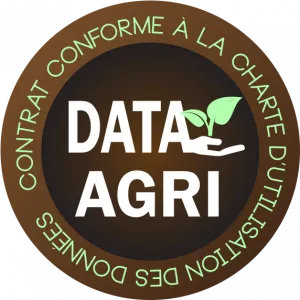

*This article was originally published in French on the former ekylibre.com website.*

From 23 February to 3 March 2019, the Ekylibristes were at the Paris International Agricultural Show and at SIMA (the international agri-equipment show) in Paris. On this occasion, FNSEA (France's main farmers' union) and Jeunes Agriculteurs (the young farmers' union) announced the first companies to be awarded the label of the farm data protection charter: DATA-AGRI. We are very proud to announce that our label is now official.

**What is** [**the Data-Agri Charter**](https://www.data-agri.fr/) **?**

The Data-Agri label commits companies to a virtuous process for handling agricultural data. The labelling procedure is a legal audit checking that our contracts comply with this charter. The label honours companies that respect a set of ethical rules in their relationship with farmers regarding the processing of agricultural data from their farms. From the very beginning, the philosophy of Ekylibre's 2 founders has always been to respect the security, ownership and proper use of farmers' data. It was therefore only natural for us to commit to this process, which combines clarity, transparency, control and security for our customers.

[**Read the Data-Agri charter**](/data-agri-chart/)
