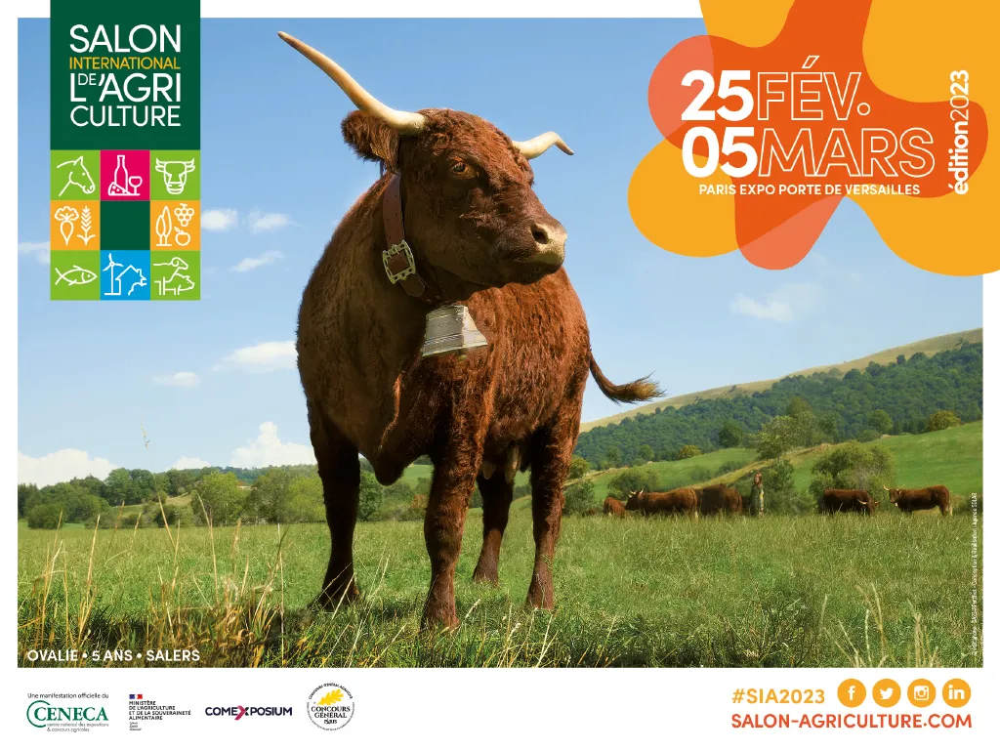

*This article was originally published in French on the former ekylibre.com website.*

### Meet us on La Ferme Digitale's stand – Hall 4 – (D069)

This year's edition of SIA (the Paris International Agricultural Show) has the theme:

### "Save money and discover interoperability"

Come along to 2 workshops to discover our new **Eky**agri | **Eky**viti Performance offers and several **partner connections**, all aimed at simplifying data exchange. Attend an exclusive talk on the synergy between several **Open Source** technologies and solutions serving farmers and winegrowers.

[View the programme](/sia2023/)
