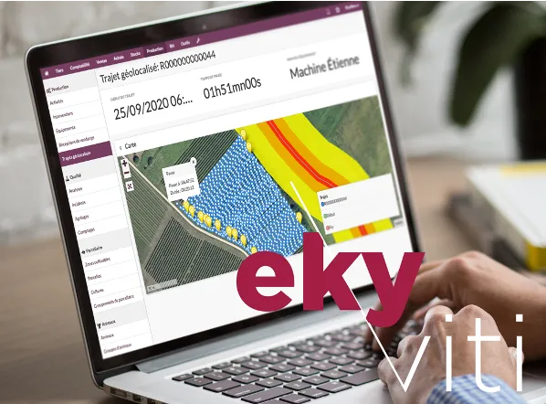
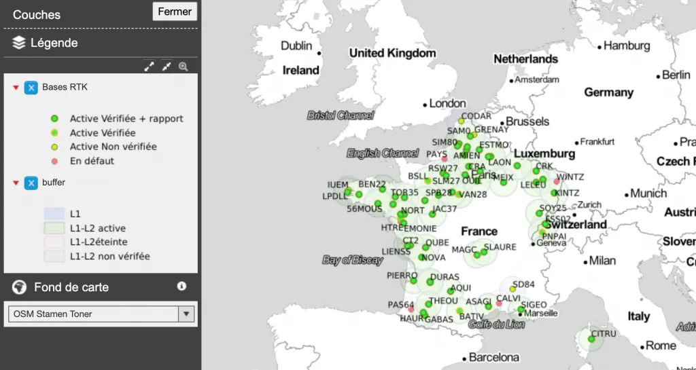

*This article was originally published in French on the former ekylibre.com website.*

Your Ekyviti software and the start-up Samsys are teaming up to simplify your daily life as a winegrower. In short: **enjoy centimetre-level precision for your field operations.**

**No more data entry in Ekyviti — your tractors do it for you!**

*Ekyviti, management software for producers in the wine and spirits sector*

### Ekyviti in a nutshell…

Ekyviti is the all-in-one management software dedicated to producers in the wine and spirits sector. With this innovative software, co-developed with our "pilot winegrowers", you manage:

- all of your vineyard production (field operations, traceability, incidents…);
- your cash flow, thanks to the purchasing and sales module (quotes, invoices, shipments, deliveries…);
- your automated accounting;
- the automatic exchange of your data with your partner tools (Weenat, **Samsys**, Baqio, Fruition Sciences, Centipède…);
- support for environmental certification (HVE3, Viticulture Durable Cognac…) and the sustainability of your farm (IDEA method);
- grape intake at harvest, simply by chatting with our conversational assistant Duke!

[See all of Ekyviti's features!](/ekyviti/)

### … and where does Samsys fit in?

Samsys is a young company based in Lille whose goal, through the development of connected boxes, is to simplify the recording of field work and give farmers more precise management of their operations. How? Using the Samsys box, magnetically attached to your tractors, and its centimetre-level precision, you automatically capture and effortlessly record all the data needed to track your activities and your teams' work.

With the Samsys software you get:

- automatic recognition of implements and drivers, with no data entry;
- visualisation of fuel consumption data;
- tyre pressure measurement;
- equipment booking, by viewing the availability of machinery and staff, etc.

[Find out more about the Samsys solution!](https://samsys.fr/)

### An interconnection that makes my life easier? *Really?*

In our view, the interoperability of tools and solutions dedicated to farming is essential for the sustainable and efficient development of farms. That is why we are committed to building technical and technological partnerships that make sense in your day-to-day activities.

Thanks to the interconnection between the Ekyviti software and the Samsys solution, simply attach the magnetic boxes to your tractors and machines. Autonomous for several weeks (no need to recharge your boxes too often) and easy to use, they let you, starting today:

- automatically track all field operations and travel times, with breaks identified (possible breakdowns, various stops, road journeys…);
- thanks to centimetre-level precision (RTK), track the spraying carried out in each vine row, detect the presence of disease on each vine and survey your vines and headlands very precisely.

### It's not Christmas yet… and yet!

*This combined offer includes all the features of the Ekyviti software (Lab version) and the Samsys solution. For just **€999 excl. VAT for the 1st year\*** (instead of €1,449/year), and only **until 24 December**, make the most of an Ekyviti software subscription with its high-precision connected box!*

\* then €749/year in subsequent years for both subscriptions

### Check my coverage!

**Is there an RTK network near me?**\
In collaboration with Centipède, check your RTK network coverage here > [https://centipede.fr/index.php/view/map/?repository=cent&project=centipede](https://centipede.fr/index.php/view/map/?repository=cent&project=centipede)

The network is growing fast! Feel free to tell us about your needs by contacting us directly at [hello@ekyviti.com](mailto:hello@ekyviti.com)

[I'd like a demo!](https://calendly.com/ekylibre/30min)
