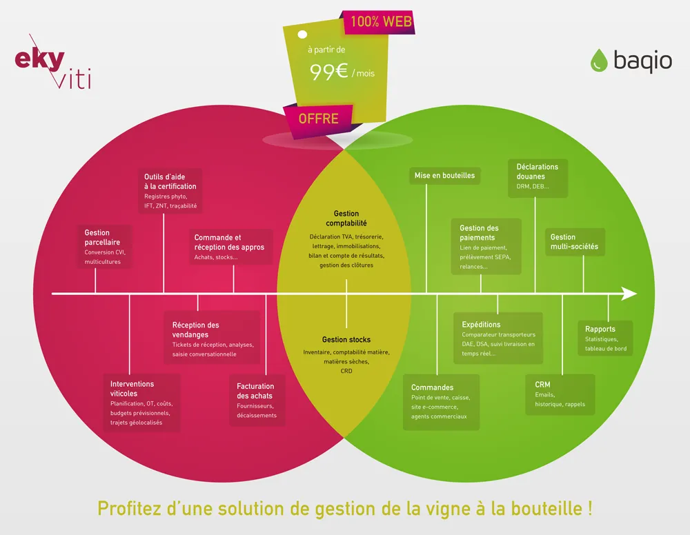

*This article was originally published in French on the former ekylibre.com website.*

\[Partnership\] Ekylibre is delighted to announce our new partnership with Baqio, a 100% online sales management solution specialising in wine and spirits.

### Why this partnership?

The aim is to make winegrowers' lives easier and help them optimise their performance with a connected all-in-one solution that is unique on the market, at an unbeatable price.

Interoperability between the two solutions will allow users of both platforms to manage the sales and accounting data of the 2 software packages automatically, without re-entering anything.

*All-in-one Ekyviti - Baqio solution*

### What's new for users?

**Eky**viti users can now benefit from advanced sales features thanks to the Baqio software. This gives them access to a set of tools that make their daily lives even easier: e-commerce shop, virtual tills, carrier comparison, management of customs declarations (DRM) and much more… All sales recorded in Baqio are then automatically synchronised and integrated into Ekyviti's accounting.

For Baqio users, this interconnection will give them all of **Eky**viti's automated accounting: VAT returns, account reconciliation, bank statements, fixed assets, real-time income statement/balance sheet, etc. They will also be able to use the vineyard production tools, such as advanced field management, traceability of operations in the vineyard, management of grape intake at harvest, etc.

### And how much does all this cost?

**Eky**viti and Baqio are offering a promotional package from €99 excl. VAT/month in total (1-year commitment on both solutions).

Would you like to discover and enjoy the **Eky**viti x Baqio solution?

[Request a demo!](https://calendly.com/ekylibre/30min)

[Download the Ekyviti x Baqio press release](https://web.archive.org/web/20251121030215/https://ekylibre.com/wp-content/uploads/2021/07/Com-presse_Ekylibre-Baqio.pdf)
