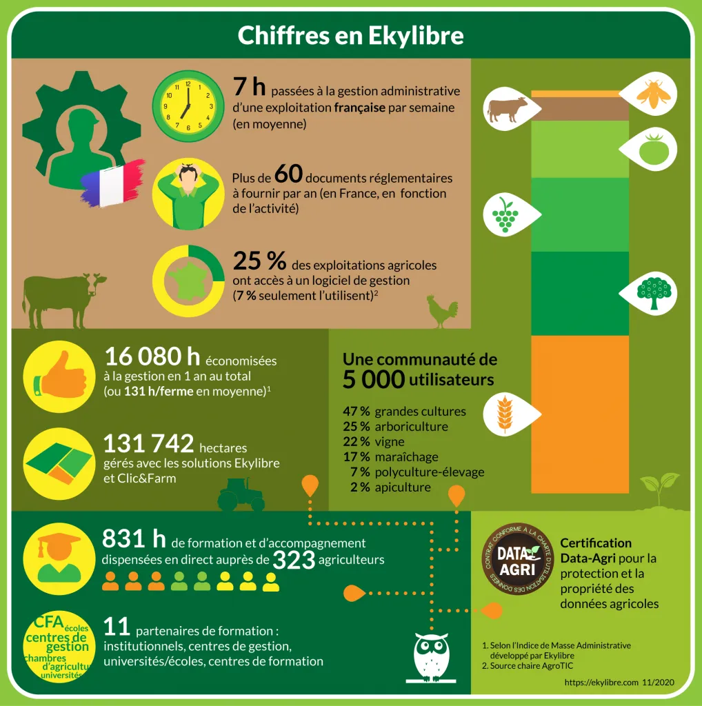

*This article was originally published in French on the former ekylibre.com website.*

### The use of digital technology in French agriculture

Agriculture is a highly diverse sector. From this diversity comes a strength capable of feeding every one of our fellow citizens. Admittedly, it is no easy task, but it is driven by passionate people, and that is why we are proud to work for and with them! As the 2020 Agricultural Census (*RGA*) gets under way, we felt it was important to draw up a detailed portrait, in figures, of our users, who have adopted our solution to support them day to day.

First of all, let's briefly recall the figures on how well equipped farmers are with digital solutions, and the impact these have on the daily lives of French farmers!

We are still waiting for the 2020 RGA figures, but out of just under 400,000 French farms, more than 50% are connected to the internet. We note that more than 85% of connected farmers use it every day. By a large majority, and despite an exponential rise in smartphone ownership between 2016 and 2018, the computer remains the preferred tool. In 2019, 55% of farmers used a smartphone (compared with 32% in 2016), but 94% used a computer (desktop or laptop). History does not yet tell us what share of them use several devices ;)… but a little bird tells me there are plenty!

All these figures, evidence of the growing digitalisation of our agriculture, are encouraging for young companies like ours that work every day to develop and support farmers' use of technology: in a word, ACCESSIBLE!

### Why Ekylibre?

On average, a farmer spends **7 hours a week** on administrative tasks (producing regulatory documents, recording field work or cash management, accounting, human resources, etc.). That's all the hours they cannot spend doing what they enjoy: their trade, their hobbies… Digital solutions are multiplying and today **1 farm in 4** has access to software, but only 7% of them use it regularly.

With Ekylibre, and thanks to our community of more than 5,000 farmers, we have already saved all our customers a combined 16,080 hours of management and data entry, an average of 131 hours per farm.

How did we calculate this? It's simple! Go to our **Administrative Mass Index** calculator here [https://ekylibre.com/pmi](/pmi/) and test yourself!… It's free 😉

### NEW TO EKYLIBRE?

[Request a demo!](https://calendly.com/ekylibre/30min)

*Sources:\
AgroTIC Chair [http://agrotic.org/observatoire/2017/11/06/usage-du-numerique-pour-la-gestion-technico-economique-des-exploitations-agricoles/](http://agrotic.org/observatoire/2017/11/06/usage-du-numerique-pour-la-gestion-technico-economique-des-exploitations-agricoles/)\
Agrinautes 2019 survey [https://leconnecteur.org/enquete-agrinautes-les-agriculteurs-internet/](https://leconnecteur.org/enquete-agrinautes-les-agriculteurs-internet/)*
