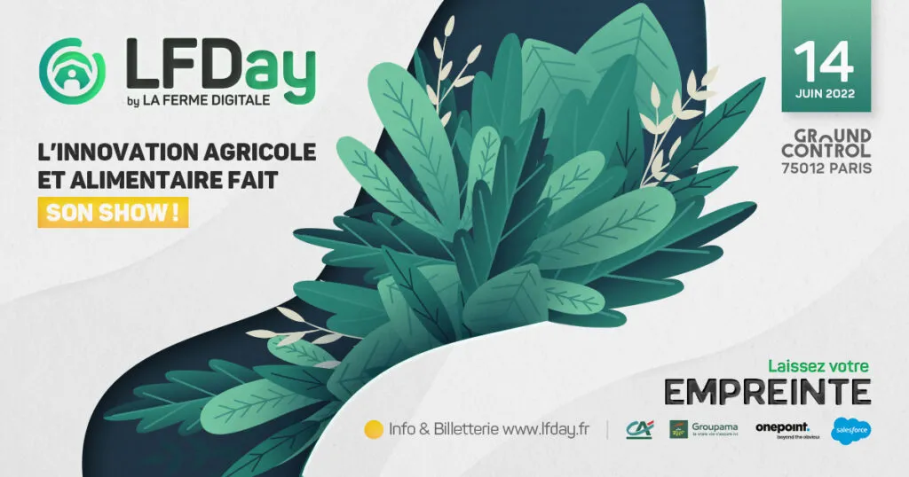

*This article was originally published in French on the former ekylibre.com website.*

### LFDay will take place on 14 June 2022

### at Ground Control - Paris 12th - 8:30 am/6:30 pm

**[La Ferme Digitale](https://www.lafermedigitale.fr/)** (the French AgTech start-up association) is holding its **[LFDay](https://lfday.fr/)** event on 14 June in Paris 12th (Ground Control). A whole day dedicated to French and international players in agricultural and food innovation. Meet more than 120 French and international start-ups, 100% AgTech.

**Ekylibre** looks forward to seeing you!

This 6th edition dedicated to agricultural and food innovation will bring together:

- 120 Agri Food start-ups (30% from abroad: Africa, the Americas, Eastern Europe…);
- 100 corporate CEOs (Groupama, Crédit Agricole, Salesforce, Bayer, John Deere, BASF, InVivo, Axéréal, Engie, BPI, FNA…);
- 100 investors;
- All the players in agricultural and food innovation. Nearly 2,000 people who want to take part in and contribute to improving the farming world;
- A programme of talks and keynotes on the **main theme: footprint** (environmental, social, economic, agricultural, territorial…);
- 40 workshops run by our partners;
- A digital platform to schedule meetings and join workshops.

We can't wait to see you. See you very soon!

**Use the code "EKYLIBRE" when completing your purchase\
and GET 20% OFF**

[Get my ticket](https://lfday.fr/billetterie/)
