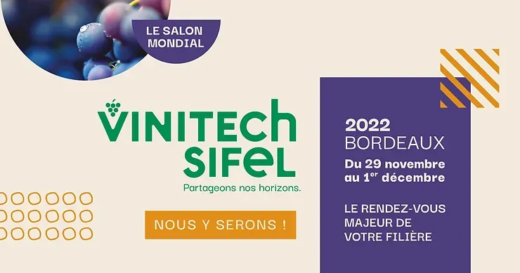

*This article was originally published in French on the former ekylibre.com website.*

### Vinitech-Sifel 2022 from 29 November to 1 December

### Bordeaux Exhibition Centre - 8:30 am/6 pm

### Meet us in Hall 1 - stand D2102, with our partner **Baqio**, to discover lots of new features!

Attend demonstrations of the **Eky**viti Production, **Eky**viti Gestion and **Eky**viti Performance solutions. The latter includes brand-new features giving farmers access to production cost and margin tracking, as well as break-even price simulations, to improve their profitability.\
Find out how to synchronise sales recorded in the **Baqio** solution so they are transferred automatically to **Eky**viti's "Accounting" module, giving you access to VAT returns and bank statement reconciliation.

**Drinks reception invitation\
Tuesday 29 November 2022 // 6 pm – 10:30 pm\
Hall 1 – stand D2102**

We would be delighted to meet you for a friendly get-together with our team and the team from **Baqio**, publisher of the sales management solution of the same name for professionals in the wine and spirits sector.\
*Access before the show closes (6 pm) or via gate B (until 7:30 pm).*
