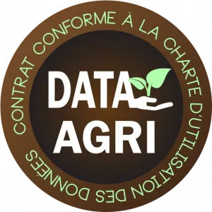

Du 23 février au 03 mars 2019, les Ekylibristes étaient présents au Salon de l’agriculture et au SIMA de Paris. A cette occasion, la FNSEA et les Jeunes Agriculteurs ont annoncé les premières entreprises labellisées par la charte de protection des données agricoles : DATA-AGRI. Nous sommes très fiers de vous annoncer l’officialisation de notre labellisation.

**Qu’est-ce que** [**la Charte Data-Agri**](https://www.data-agri.fr/) **?**

Le label Data-Agri engage les entreprises dans un processus vertueux de traitement des données agricoles. La procédure de labellisation est une procédure d’audit juridique vérifiant la compatibilité entre nos contrats et cette charte. Ce label met à l’honneur les entreprises qui respectent un ensemble de règles éthiques dans leur relation avec les agriculteurs, au sujet du traitement des données agricoles issues de leurs exploitations.A l’origine, la philosophie des 2 fondateurs d’Ekylibre a toujours été de respecter la sécurité, la propriété et le bon usage des données de l’agriculteur. Il était donc pour nous inévitable de nous engager dans ce processus alliant lisibilité, transparence, maîtrise et sécurité pour nos clients.

[**Consultez la charte Data-Agri**](/data-agri-chart/)
