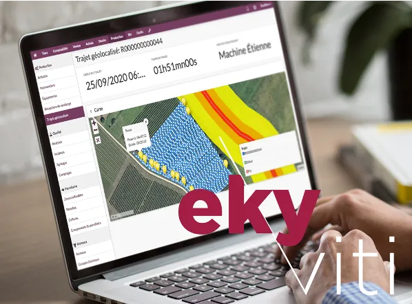
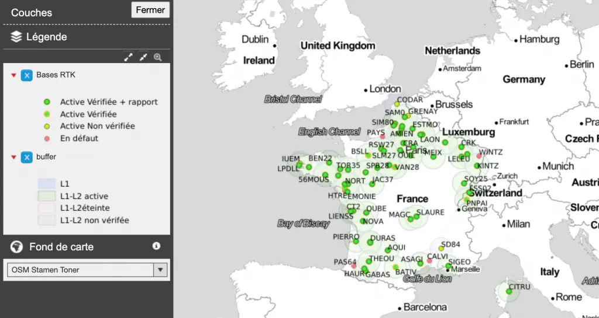

Votre logiciel Ekyviti et la start-up Samsys s’associent pour simplifier votre quotidien de viticulteur. En quelques mots : **Profitez d’une précision centimétrique de vos interventions.**

**Plus aucune saisie sur Ekyviti, vos tracteurs s’en chargent !**

*Ekyviti, logiciel de gestion au service des producteurs de la filière vin et spiritueux*

### Ekyviti en quelques mots…

Ekyviti c’est le logiciel de gestion tout-en-un dédié aux producteurs de la filière vin et spiritueux. Grâce à ce logiciel innovant, co-construit avec nos “viticulteurs-pilotes”, vous gérez :

- l’ensemble de votre production viticole (interventions, traçabilité, incidents…) ;
- votre trésorerie grâce au module de gestion des achats et ventes (devis, factures, expéditions, livraisons…) ;
- votre comptabilité automatisée ;
- l’échange automatique de vos données avec vos outils partenaires (Weenat, **Samsys**, Baqio, Fruition Sciences, Centipède…) ;
- l’aide à la certification environnementale (HVE3, Viticulture Durable Cognac…) et la durabilité de votre exploitation (méthode IDEA) ;
- la réception de vendange en discutant avec notre assistant conversationnel Duke !

[Voir toutes les fonctionnalités d’Ekyviti !](/ekyviti/)

### … et Samsys dans tout ça ?

Samsys est une jeune entreprise lilloise ayant pour objectif, grâce au développement de boîtiers connectés, de simplifier la saisie du travail au champ et de permettre à l’exploitant une gestion plus précise de ses interventions. Comment ? À l’aide du boîtier Samsys, aimanté sur vos tracteurs, et à sa précision centimétrique, relevez automatiquement et enregistrez sans effort toutes les données nécessaires au suivi de vos activités et du travail de vos équipes.

Avec le logiciel Samsys vous accédez à :

- la reconnaissance des attelages et des chauffeurs, sans saisie ;
- la visualisation des données de consommation carburant ;
- la mesure de la pression pneumatique ;
- la réservation des matériels par la visualisation de la disponibilité des matériels et des salariés etc.

[En savoir plus sur la solution Samsys !](https://samsys.fr/)

### Une interconnexion qui me simplifie la vie ? *Really ?*

L’interopérabilité des outils et des solutions dédiés aux métiers de l’agriculture est selon nous essentielle pour une évolution durable et performante des exploitations. Pour cela, nous avons à cœur de développer des partenariats techniques et technologiques qui ont du sens dans vos activités quotidiennes.

Grâce à l’interconnexion du logiciel Ekyviti à la solution Samsys, aimantez simplement vos boîtiers sur vos tracteurs et machines. Autonomes plusieurs semaines (pas besoin de recharger vos boîtiers trop régulièrement) et simples d’utilisation, vous pouvez dès aujourd’hui :

- suivre automatiquement toutes les interventions et les temps de trajets réalisés avec identification des pauses (pannes éventuelles, pauses diverses, trajets sur route…) ;
- grâce à sa précision centimétrique (RTK), suivre les pulvérisations réalisées dans chaque rang de vigne, détecter la présence de maladies à chaque pied et réaliser un arpentage très précis des vignes et des tournières.

### Ce n’est pas encore Noël… Et pourtant !

*Cette offre combinée inclut l’ensemble des fonctionnalités du logiciel Ekyviti (version Lab) et de la solution Samsys. Pour seulement **999€ HT la 1ère année\*** (au lieu de 1449€/an), et ce **jusqu’au 24 décembre** seulement profitez pleinement de l’abonnement au logiciel Ekyviti avec son boîtier connecté haute précision !*

\* puis 749€/an les années suivantes pour les deux abonnements

### Je vérifie ma couverture !

**Y a-t-il un réseau RTK proche de chez moi ?**\
En collaboration avec Centipède, vérifiez ici votre couverture en réseau RTK > [https://centipede.fr/index.php/view/map/?repository=cent&project=centipede](https://centipede.fr/index.php/view/map/?repository=cent&project=centipede)

Le réseau se construit rapidement ! N’hésitez pas à nous faire part de vos besoins en nous contactant directement [hello@ekyviti.com](mailto:hello@ekyviti.com)

[Je souhaite une démo !](https://calendly.com/ekylibre/30min)
