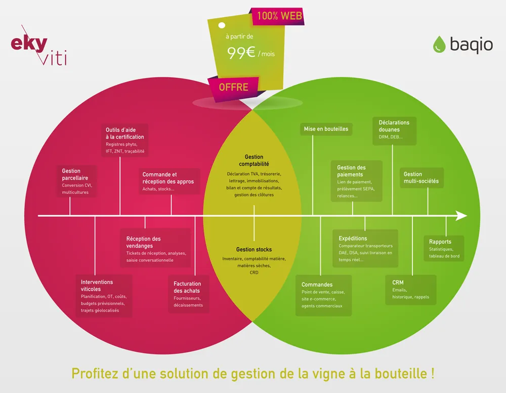

\[Partenariat\] Ekylibre est très heureux de vous annoncer notre nouveau partenariat avec Baqio, une solution de gestion commerciale 100% en ligne spécialisée vin et alcool.

### Pourquoi ce partenariat ?

L’objectif est de simplifier la vie des viticulteurs et de les accompagner dans l’optimisation de leur performance grâce à une solution connectée tout-en-un inédite sur le marché et à un prix imbattable.

L’interopérabilité entre les deux solutions permettra aux utilisateurs des deux plateformes de gérer automatiquement et sans ressaisie les données commerciales et comptables des 2 logiciels.

*Solution tout-en-un Ekyviti - Baqio*

### Qu’est-ce que cela apporte de nouveau aux utilisateurs ?

Les utilisateurs d’**Eky**viti peuvent maintenant bénéficier des fonctionnalités avancées de commercialisation grâce au logiciel Baqio. Cela leur permet d’avoir accès à un ensemble d’outils qui facilitent encore plus leur quotidien : boutique e-commerce, caisses virtuelles, comparateur de transporteur, gestion des déclarations de douane (DRM) et bien plus encore… Toutes les ventes enregistrées sur Baqio sont ensuite automatiquement synchronisées et intégrées dans la comptabilité d’Ekyviti.

Pour les utilisateurs de Baqio, cette interconnexion leur permettra de bénéficier de toute la gestion automatisée de la comptabilité d’**Eky**viti : déclaration de TVA, lettrage, relevés bancaires, immobilisations, compte de résultat/bilan en temps réel, etc. Ils pourront également utiliser les outils de production viticole comme par exemple la gestion avancée du parcellaire, la traçabilité des interventions à la vigne, la gestion des réceptions des vendanges, etc.

### Et combien cela coûte tout ça ?

**Eky**viti et Baqio proposent une offre promotionnelle à partir de 99 € ht/mois au global (1 an d’engagement sur les 2 solutions).

Vous souhaitez découvrir et profiter de la solution **Eky**viti x Baqio ?

[Demandez une démo !](https://calendly.com/ekylibre/30min)

[Télécharger le communiqué de presse Ekyviti x Baqio](https://web.archive.org/web/20251121030215/https://ekylibre.com/wp-content/uploads/2021/07/Com-presse_Ekylibre-Baqio.pdf)
