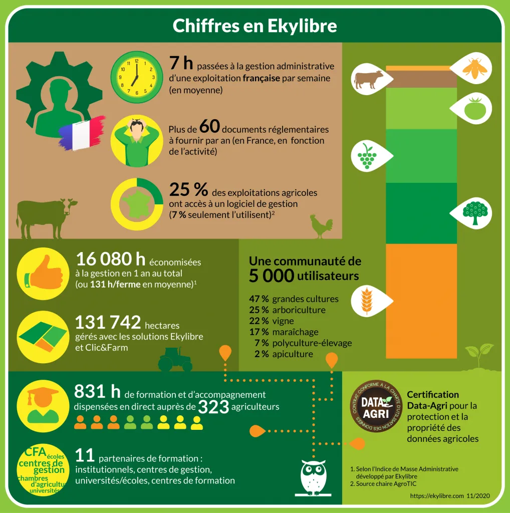

### L’usage du numérique dans l’agriculture française

L’agriculture est un secteur très diversifié. De cette diversité naît une force capable de nourrir chacun de nos concitoyens. Certes, la manœuvre n’est pas aisée, mais elle est faite de passionné(e)s et c’est en cela, que nous sommes fiers de travailler pour et avec eux ! A l’aube du lancement du Recensement Agricole 2020 (*RGA*), il nous paraissait important de dresser un portrait qualifié et chiffré de nos utilisateurs, qui ont adopté notre solution pour les accompagner au quotidien.

Tout d’abord, faisons ensemble un court rappel des données relatives aux taux d’équipement en solutions numériques, et de leur impact sur le quotidien de nos agriculteurs français !

Nous attendons encore les chiffres du RGA 2020, mais sur un peu moins de 400 000 exploitations agricoles françaises, plus de 50 % d’entre elles sont connectées à Internet. Nous remarquons que l’usage de ce réseau est quotidien pour plus de 85 % des agriculteurs connectés. En grande majorité, et malgré une hausse exponentielle entre 2016 et 2018 de l’équipement en smartphone, l’ordinateur reste l’outil privilégié. En 2019, 55% des agriculteurs utilisent un smartphone (contre 32% en 2016), mais 94% utilisent un ordinateur (fixe ou portable). L’Histoire ne nous dit pas encore quelle part d’entre eux est multi-connecté ;)… mais mon petit doigt me dit qu’ils sont nombreux !

Tous ces chiffres, constats de la digitalisation croissante de notre agriculture, sont encourageants pour nos jeunes entreprises qui s’investissent au quotidien pour l’évolution et l’accompagnement de nos exploitants agricoles à l’usage de la technologie : en un mot ACCESSIBLE !

### Pourquoi Ekylibre ?

En moyenne, un exploitant passe **7h par semaine** penché sur sa gestion administrative (édition de documents réglementaires, saisies diverses des travaux au champ ou de gestion de trésorerie, comptabilité, ressources humaines etc.). Autant d’heures qu’il ne peut pas consacrer à faire ce qui lui plaît : son métier, ses loisirs… Les solutions numériques se multiplient et aujourd’hui, **1 exploitation sur 4** a accès à un logiciel mais seulement 7 % d’entre elles l’utilisent régulièrement.

Avec Ekylibre, et grâce à notre communauté de plus de 5 000 agriculteurs, nous avons déjà fait économiser 16 080 heures de gestion et de saisie à tous nos clients, soit une moyenne de 131 heures par exploitation.

Comment a-t-on calculé cela ? C’est simple ! Rendez-vous sur notre outil de calcul de l’**Indice de Masse Administrative** disponible ici [https://ekylibre.com/pmi](/pmi/) et testez-vous !… C’est gratuit 😉

### VOUS DÉCOUVREZ EKYLIBRE ?

[Demandez une démo !](https://calendly.com/ekylibre/30min)

*Sources :\
Chaire AgroTIC [http://agrotic.org/observatoire/2017/11/06/usage-du-numerique-pour-la-gestion-technico-economique-des-exploitations-agricoles/](http://agrotic.org/observatoire/2017/11/06/usage-du-numerique-pour-la-gestion-technico-economique-des-exploitations-agricoles/)\
Enquête Agrinautes 2019 [https://leconnecteur.org/enquete-agrinautes-les-agriculteurs-internet/](https://leconnecteur.org/enquete-agrinautes-les-agriculteurs-internet/)*
