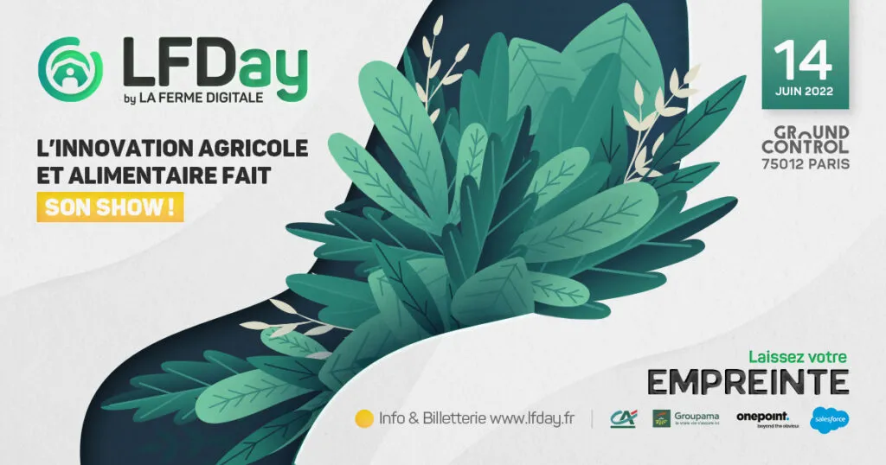

### Le LFDay se déroulera le 14 juin 2022

### au Ground Control - Paris 12e - 8h30/18h30

**[La Ferme Digitale](https://www.lafermedigitale.fr/)** organise son événement le **[LFDay](https://lfday.fr/)** le 14 juin à Paris 12e (Ground Control). Une journée entièrement dédiée aux acteurs français et internationaux de l’innovation agricole et alimentaire. Rencontrez plus de 120 start-up françaises et internationales 100 % AgTech.

**Ekylibre** vous attend !

Cette 6ème édition dédiée à l’innovation agricole et alimentaire rassemblera :

- 120 start-up Agri Food (dont 30 % de l’étranger : Afrique, Amérique, Europe de l’Est…) ;
- 100 CEO de corporates (Groupama, Crédit Agricole, Salesforce, Bayer, John Deere, BASF, InVivo, Axéréal, Engie, BPI, FNA…) ;
- 100 investisseurs ;
- Tous les acteurs de l’innovation agricole et alimentaire. Près de 2000 personnes qui veulent participer et contribuer à améliorer le monde agricole ;
- Un programme de conférences et keynotes autour du **thème principal : l’empreinte** (environnementale, sociétale, économique, agricole, territoriale…) ;
- 40 workshops animés par nos partenaires ;
- Une plateforme digitale pour programmer meetings et participer aux workshops.

Hâte de vous retrouver. À très bientôt !

**Utilisez le code « EKYLIBRE » lors de la validation de votre achat\
et PROFITEZ DE 20% DE RÉDUCTION**

[Je prends mon billet](https://lfday.fr/billetterie/)
