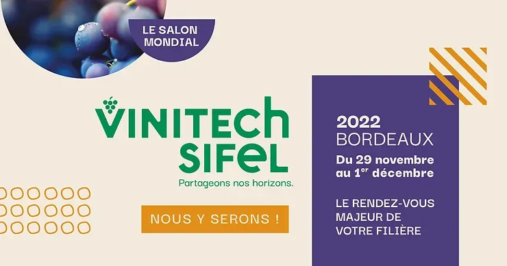

### Vinitech-Sifel 2022 du 29 novembre au 1er décembre

### Parc des expositions de Bordeaux - 8 h 30/18 h

### Retrouvez-nous, Hall 1 - stand D2102, avec notre partenaire **Baqio** pour découvrir de nombreuses nouveautés !

Assistez aux démonstrations des solutions **Eky**viti Production, **Eky**viti Gestion et **Eky**viti Performance. Cette dernière offre intègre de nouvelles fonctionnalités inédites pour permettre aux exploitants d’avoir accès au suivi des coûts de production, des marges ainsi qu’à des simulations des prix d’équilibre afin d’améliorer leur rentabilité.\
Découvrez comment synchroniser les ventes enregistrées avec la solution **Baqio** pour les transférer automatiquement dans le module « Comptabilité » d’**Eky**viti et accéder ensuite aux déclarations de TVA et aux pointages de relevés de compte bancaires.

**Invitation apéritif\
Mardi 29 novembre 2022 // 18 h – 22 h 30\
Hall 1 – stand D2102**

Nous serions ravis de vous rencontrer pour un moment convivial avec notre équipe et celle de **Baqio**, éditeur de la solution éponyme de gestion commerciale à destination des professionnels de la filière vin et spiritueux.\
*Accès avant la fermeture du salon (18 h) ou via la porte B (jusqu’à 19 h 30).*
